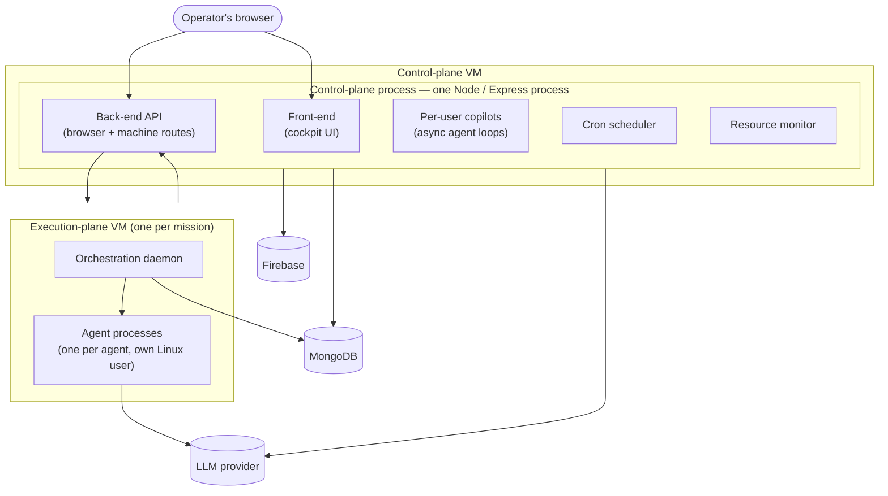
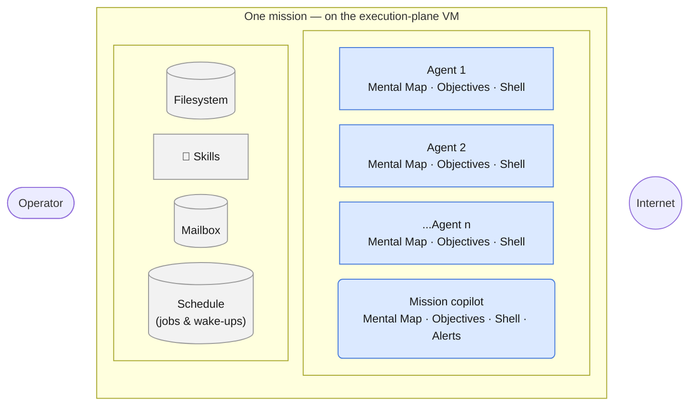

# MAGI V3

MAGI V3 runs teams of AI agents on long-running, autonomous missions — not a single prompt and
response, but a team that works for days or weeks, coordinating with each other and with a human
operator through a persistent mailbox.

A mission is built around a handful of core ideas:

- **Objectives.** An agent's work stays tied to an explicit, structured goal, not an assumption
  baked into a prompt. Objectives form a tree (goals → tasks → KPIs), and LLM cost is attributed
  back down that tree, so you can see what a specific piece of work actually cost.
- **The Mental Map.** What an agent currently knows and is working toward lives in a structure it
  maintains itself across the whole mission, not an ever-growing transcript. Its high-level shape
  can be enforced by the operator, alongside detailed instructions.
- **A computer of its own.** Each mission runs on its own dedicated virtual machine, isolated from
  your own computer and from every other mission. Inside it, agents get a real shell and a shared
  filesystem — not a curated set of safe calls — with each agent running as its own ACL'd Linux
  user. The operator can inspect, edit, and download or upload any of these files.
- **A copilot for each mission.** An agent whose job isn't the mission's actual work, but the
  mission itself: it watches for the gap between an agent's stated objective, its Mental Map, and
  what it's actually been doing; helps configure the team — prompts, objectives, limits — so the
  operator doesn't have to do it screen by screen; and can act on what it finds, from pausing an
  agent to filing a GitHub issue with real context, because it can read the codebase itself.
- **A copilot for the platform.** One per person, not per mission. Its main job is helping you
  define and launch a new mission in the first place; once missions are running, it also keeps an
  eye on everything you have going.
- **A layered backstop on spend.** Nothing about an LLM-driven system stops it from spending
  without limit on its own, so MAGI doesn't rely on a single safeguard: a hard cap at your LLM
  provider (no auto-replenishment) is the outermost layer, MAGI's own hard limits on cost and
  call-count stop a turn outright, and softer thresholds alert the mission's copilot before
  anything reaches a hard ceiling. How the layers fit together: [docs/spend-limits.md](docs/spend-limits.md).
- **Sub-agents, not just tool calls.** Some tool calls are themselves small agents: `Research`
  delegates a question to its own nested agent, with its own LLM budget and isolated context, and
  returns a synthesized finding the whole team can reuse. Browsing the web is different but similar
  in spirit — an interactive session, with cookies and logins that persist across calls, not a
  stateless fetch.
- **Skills, extensible at runtime.** An agent's abilities aren't fixed to what ships in the core —
  skills are recipes and scripts that can be run on demand or scheduled to run later, and any
  agent, a copilot especially, can author a new one for itself or the whole team without anyone
  touching the core agent loop.

For security, none of this happens on your own computer: missions run on isolated cloud machines
(one per mission, plus one control-plane machine managing all of them). Agents and the scripts they
run never hold a credential — not your personal accounts, not the platform's LLM or database
credentials, not the third-party data-provider keys (FRED, FMP, NewsAPI), which background jobs
reach only through narrow, authenticated calls to the mission's daemon. One limit to know about: that
daemon, on each mission's machine, does hold the platform's database and LLM credentials, which are
shared across missions today; per-tenant isolation of those is planned (Sprint 29, see
[docs/security/threat-model.md](docs/security/threat-model.md)).

MAGI works with your LLM provider of choice — Anthropic and OpenRouter today — rather than being
tied to one, thanks to [pi-ai](https://github.com/earendil-works/pi), the open-source
multi-provider LLM library it's built on.

---

## Architecture at a glance

Two views: how missions are hosted, and what happens inside one of them once it's running.

**Platform topology.** The control plane is the only always-on machine; every mission gets its own
execution-plane machine, provisioned on demand and suspended when idle. Both are plain virtual
machines — the boxes below are the processes running on them, not separate services:



The control plane is one Node/Express process, not separate services — but within it, these are
distinct logical components:

- **Front-end.** The cockpit's static SPA (HTML/JS/CSS), served by the same process at the same
  origin as the API it calls.
- **Back-end API.** Really two APIs sharing that one process: a Firebase-authenticated one the
  cockpit calls (mission CRUD, usage, chatting with your own copilot), and a separate,
  token-authenticated one that execution-plane machines call back into (today: the mission
  copilot's GitHub-proxy tools). This is also the component that provisions, resumes, and suspends
  a mission's machine on demand via the Fly Machines API.
- **Per-user copilots.** One per user, not one per mission, each running as its own async
  agent-loop task inside this same process rather than a separate one. Its regular shell/file
  tools run isolated under a dedicated `magi-copilot` Linux user via sudo; its more sensitive
  "elevated" tools (MongoDB and Fly API access) run in-process with no such isolation — a known,
  deliberate trade-off, not an oversight (see the security note above). Mainly helps a user define
  and launch a new mission, and otherwise watches across that user's own missions at a coarse
  grain.
- **Cron scheduler.** A once-a-minute heartbeat with three fixed jobs: deliver any due scheduled
  message into its mission's mailbox, or hand a due scheduled job to the mission's daemon
  (resuming a suspended machine if needed), expire any
  temporary resource upgrade that's run past its window, and prune old LLM call-log entries. It
  lives here, not on a mission's own machine, because that machine is suspended between sessions
  and can't reliably drive its own clock.
- **Resource monitor.** A separate five-minute tick ([ADR-0032](docs/adr/0032-proactive-resource-oversight.md))
  that checks resource usage platform-wide — shared MongoDB Atlas storage, each mission's disk —
  raises anomaly alerts to the relevant copilot, and produces each user's daily resource report.

And on the execution plane:

- **Orchestration daemon.** The persistent process on a mission's own machine. It sleeps between
  wakeups via a MongoDB Change Stream rather than polling, and drives the agent loop whenever a
  message, a schedule, or a condition wakes it.
- **Agent processes.** Each agent's shell and file tool calls run as a real OS subprocess under
  that agent's own dedicated Linux user, ACL'd to its own workspace, spawned by the daemon through
  a narrowly-scoped sudo rule — the actual isolation boundary behind "a computer of its own."

Everything a mission's own daemon and agents do beyond that — reading/writing state, waking up,
coordinating — goes through MongoDB, not a direct line to the control plane. Full design:
[docs/adr/0013-cloud-execution-architecture.md](docs/adr/0013-cloud-execution-architecture.md).

**Inside a mission.** A layout pass — positions only, relationships to be wired back up once this
reads cleanly. The mission copilot sits as a peer in the same row as the other agents, rightmost.
Each agent's own Mental Map, its view of the objectives tree, and its shell are noted inline on its
own box rather than drawn separately. The filesystem, the skill system, the mailbox, and the
schedule of future jobs and wake-ups are all shared at the mission level, not owned by any one
agent — any agent can register a job or a wake-up, but it lives alongside the mission, not inside
the agent that created it.



- **Agent 1 / Agent 2 / …Agent n.** A team can define as many agents as it needs. Each one is a genuine OS process of its own (its own Linux user, its own subprocess for shell commands). Breaking down an overall mission statement into separate tasks is useful to focus the context of each agent, very much like a team of people allows a separation of tasks and specialties. Each agent has a supervisor, which can be another agent, or the human operator. Agents will communicate with each other as they see fit, and will also communicate with the human operator. Agents run concurrently, i.e. several agents may be calling the LLM, making changes to the filesystem or browsing the internet to progress on their own tasks at the same time.
  - **Mental Map.** The agent's own working memory: a structured document it maintains and updates
    itself across the whole mission, replacing an ever-growing raw transcript. Private by default — but the human operator and copilot can read and edit it.
  - **Objectives.** A formal list of objectives, tasks and KPIs are defined by the human operator and mission copilot. Objectives and tasks are assigned to agents, which are asked to maintain the relevant KPIs and to allocate their token spend to the tasks. This is complementary to the system prompt and mental map, to further help with alignment.
  - **Shell.** Each can execute bash commands in its own subprocess under its own username, spawned by the daemon via a narrowly-scoped sudo rule — what makes "its own computer" an actual isolation boundary rather than a figure of speech.
- **Mission copilot.** An agent with some privileged tools and a predefined system prompt, objectives and mental map structure. It helps the human operator define and monitor the alignment and health of the mission. It can file GitHub issues when something's wrong. Underneath, it's still just another agent process.
- **Filesystem.** Agents can access the mission's virtual machine filesystem through their bash shell. They are constrained by the OS-level ACLs: agents can write to their home directory and to a shared mission folder. The human operator can navigate and view the content of the filesystem through the mission cockpit user interface. It is possible to download and upload files. The human operator can edit certain types of files directly through the UI; in this case, the agent that last touched the file will receive a message alerting it that the file has changed. The shared folder is automatically versioned through git at every turn. The entire file-system is automatically backed up by Fly.io for 30 days.
- **Skills.** The mission's pluggable capability library: recipes and scripts any agent can run on
  demand or schedule for later, and that any agent — a copilot especially — can extend by authoring a
  new one, without anyone touching the core agent loop. Mission templates ship with predefined skills, but the human operator, copilot or agents themselves can create or modify skills too. A skill is a file that sits on the filesystem, that an agent can consult at will when it needs to perform a specific task. A skill can also include scripts or code snippets. A list of its available skills (with a short description of what they are useful for) is automatically injected into each agent's LLM context.
- **Mailbox.** The single communication channel for everything: operator to agent, agent to agent, agent to
  copilot, even the system itself (a delivered wake-up shows up with `from: "scheduler"`). A message has a single originator but can be routed to more than one recipient. 
- **Schedule (jobs & wake-ups).** Mission-level state, not agent-owned. Any agent can register a
  future wake-up or submit a background job, but it's visible mission-wide from that point on — it's
  the control plane's own cron scheduler that actually delivers it on time, resuming the mission's
  machine first if it's gone to sleep.
- **Internet.** Direct, per-agent access via that agent's own tool calls (search, fetch, browsing) —
  not a shared mission resource the way the filesystem or mailbox are. Each agent's requests are its
  own; there's no shared browsing session across agents.

**No API keys where agents can reach them.** Agents, their shell tools, and the scripts they
schedule never hold a credential directly — not the platform's own LLM key, not a GitHub token, not
a third-party data-provider key. Anything that needs one calls back, authenticated, to the one
process that actually holds it, instead of the key ever being handed out. That constraint shapes
how several tools are built — see [ADR-0011](docs/adr/0011-background-jobs-tool-ipc.md) for why
and what it costs.

All architecture decisions are recorded as ADRs in [docs/adr/](docs/adr/); the security model and
threat boundaries are documented in [docs/security/threat-model.md](docs/security/threat-model.md).

---

## Status

**MVP complete.** The system runs end-to-end, locally and in the cloud: agent teams coordinate, use tools, persist state across restarts, wake on schedule, and are managed through a multi-tenant cloud control plane with a cockpit UI and a per-user AI copilot. Current work is operational and security hardening ahead of a production launch — see [MAGI_V3_ROADMAP.md](MAGI_V3_ROADMAP.md) for the full sprint history and what's next.

---

## ⚠ Safety warning

This system runs AI agents that execute shell commands, write files, browse the web, and message each other — autonomously, for extended periods, with minimal human supervision.

!!!DO NOT GIVE YOUR AGENTS THE PASSWORDS TO YOUR OWN ACCOUNTS!!! 
You never know what they could do in your name...

!!!THINK THREE TIMES BEFORE GIVING THEM ANY OTHER SENSITIVE INFORMATION, AND THEN DO NOT DO IT ANYWAY!!! 
Your information will be written at external providers (Fly.io, MongoDB Atlas, and of course your LLM providers). The plaform has not undergone any pen-testing.

!!!ALWAYS MAINTAIN A HARD SPEND LIMIT AT YOUR LLM PROVIDER (and do not use auto-replenish features)!!! 
MAGI-V3 ships with its own limit system, but better safe than sorry.

- **Agents execute real shell commands.** A confused or manipulated agent can delete files, make network requests, or exhaust disk. Review `permittedPaths` before deploying.
- **Web content is untrusted.** The trust-boundary headers are a mitigation, not a guarantee. Do not point agents at adversarial content and ask them to act on it without human review checkpoints.
- **API costs are real.** Set `MAX_COST_USD` in your environment. A misconfigured cron schedule can accumulate significant spend.
- **The security model has had internal review** (see `docs/security/`) but no independent audit. Browser process isolation is a known gap (Playwright runs in the orchestrator process), documented and deferred.

Use this in a controlled environment. The monitor and control-plane endpoints are authenticated; do not disable that.

---

## Deployment

MAGI V3 is meant to run on Fly.io, behind the control plane's cockpit UI — that's the supported
way to actually use it, not a local process on your own machine.

**Prerequisites:**

- **An API key for a supported LLM provider** — Anthropic, OpenRouter, or another provider
  reachable through [pi-ai](https://github.com/earendil-works/pi)
- **A MongoDB cluster** — a free tier at https://www.mongodb.com/atlas works to start
- **A Fly.io account and the `flyctl` CLI**
- **A Firebase project** — for Google Sign-In on the cockpit

**Optional:**

- **Brave Search API key** — enables the `SearchWeb` tool. Free tier (2 000 req/month) at https://brave.com/search/api/
- **Data API keys** (`FRED_API_KEY`, `FMP_API_KEY`, `NEWSAPIORG_API_KEY` in `.env.data-keys`) — enable the data-factory adapters

```bash
cp secrets.env.template secrets.env   # fill in your LLM provider key, MONGODB_URI, CONTROL_API_KEY
bash scripts/bootstrap.sh             # create apps, set secrets, build + deploy
bash scripts/deploy-missions.sh       # always use this to update the execution-plane image
```

Once deployed, sign in at the control plane's URL with Google, pick a template, and launch a
mission from the cockpit.

Full guide (app naming, GitHub Actions, operations, cost, troubleshooting): [docs/deployment.md](docs/deployment.md).

---

## Development

The rest of this section is for working on MAGI itself — running a mission as a local process for
development and debugging. It isn't how MAGI is meant to be used day to day; see
[Deployment](#deployment) above for that.

**Prerequisites:**

- **Node.js 22.15+** — `node --version` to check
- **An API key for a supported LLM provider** (see Deployment above)
- **MongoDB** — local (`mongod`) or Atlas. The default URI is `mongodb://localhost:27017`.
- **Playwright Chromium** (optional) — enables the `BrowseWeb` tool for JS-rendered pages

**Linux only — OS isolation setup:**

The system runs each agent's shell tools as a dedicated OS user (`magi-w1`, `magi-w2`, …). This
requires the pool users and a sudoers rule. `setup-dev.sh` creates them, sets up the Python venv
used by the data factory, and configures `/etc/sudoers.d/magi`:

```bash
sudo env NODE_BIN=$(which node) scripts/setup-dev.sh
```

(Pass `NODE_BIN` explicitly — a bare `sudo` picks the wrong node under nvm.) This is required for integration tests and the full daemon.

**Install:**

```bash
git clone https://github.com/arnadu/magi_v3 && cd magi_v3
npm install && npm run build

cp .env.example .env
# Edit .env — set your LLM provider key and MONGODB_URI at minimum

# Optional: headless browser support
cd packages/agent-runtime-worker && npx playwright install chromium && cd ../..
```

**Running a mission locally:**

Worker commands live in the `agent-runtime-worker` package — run them with
`-w packages/agent-runtime-worker` from the repo root (or `cd` into the package first).

```bash
# Single-turn CLI:
TEAM_CONFIG=config/teams/test/word-count.yaml \
  npm run cli -w packages/agent-runtime-worker -- "count the words"

# Persistent daemon (waits for messages, runs indefinitely):
TEAM_CONFIG=config/teams/equity-research.yaml npm run daemon -w packages/agent-runtime-worker
# Dashboard: http://localhost:4000 — click ▶ Start

# Post a message to a running daemon:
TEAM_CONFIG=config/teams/equity-research.yaml \
  npm run cli:post -w packages/agent-runtime-worker -- --to lead-analyst "What is NVDA's current recommendation?"

# Watch replies:
TEAM_CONFIG=config/teams/equity-research.yaml npm run cli:tail -w packages/agent-runtime-worker

# LLM usage / cost report:
TEAM_CONFIG=config/teams/equity-research.yaml npm run cli:usage -w packages/agent-runtime-worker
```

**Tests:**

```bash
npm test                  # unit tests — no LLM, no network
npm run test:integration  # full stack — requires an LLM provider key + MONGODB_URI (and pool users)
npm run lint
```

---

## Repository layout

```
packages/
  control-plane/          — Express API (missions CRUD + lifecycle), Fly client, cron scheduler, copilot, proxy, UI
  agent-runtime-worker/   — daemon, agent loop, tools, orchestrator, monitor server, tool IPC server, CLI
  agent-config/           — YAML team config loader (Zod schema)
  skills/                 — platform-tier skill playbooks
config/
  teams/                  — team YAML configs (equity-research, gold-digest, general-assistant; test/ for fixtures)
docs/
  adr/                    — architecture decision records
  deployment.md           — cloud deployment guide
  security/               — threat model, findings, security practice
  operational-resilience.md, implementation-history.md
scripts/                  — dev setup, bootstrap, deploy, promote, mission-state reconcile, audit gates
```

---

*Built with [Claude Code](https://claude.ai/code).*
