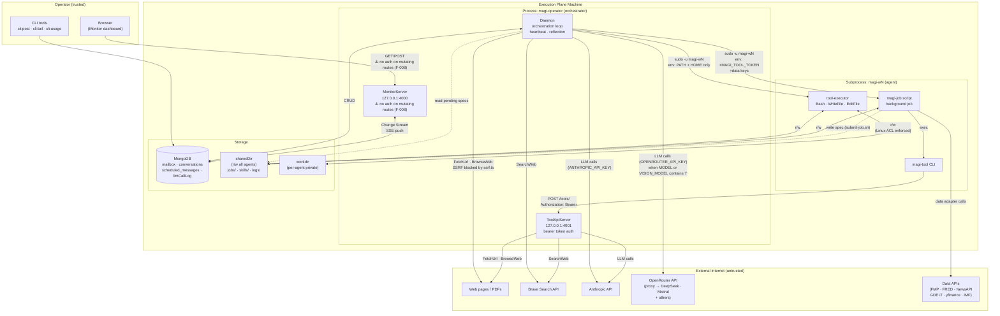
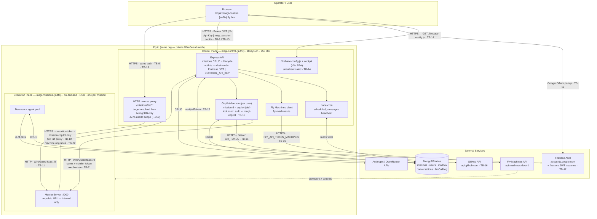

# MAGI V3 Threat Model

**Last updated:** 2026-10-17 (Sprint 28f, M4, ADR-0033 §3) — schedule ingestion built (SCHED1/SCHED2): the daemon now acts on agent-written `shared/schedules/*.json`, a new agent-controlled input to a privileged actor (TB-4/TB-7 class). Guarded like background jobs: owner-uid attribution, symlink/hard-link/daemon-owned refusal, roster-checked recipients, a job schedule may only name its author, cron floor, run-time re-validation of the job spec; the control plane only ever stamps `pendingFire` on `kind: "job"` documents (no path or identity crosses from the file to the control plane). Row added to `trust-boundaries.md`.
**Previously:** 2026-10-17 (Sprint 28f, M3 G) — **F-069** (BS1/BS2/BS4, RECON1/RECON2, DOCK4+SD1, DOCK5, ISO2+DK1, MIG1, H1): deployment and operations scripts no longer destroy live mission machines or hand secrets to `ps`; `--purge-orphans` is plan-then-`--yes` with attachment/mount/age guards; images pinned by digest; `/opt/magi-src` is root-owned and only *verified* by the daemon, so a daemon-side confused deputy can no longer rewrite what the mission copilot reads (strengthens TB-3/TB-19); background-job `env_keep` reduced to the Tool API pair (TB-4/TB-5). No new boundary.
**Previously:** 2026-10-17 (Sprint 28f, M3 F, part 2) — **F-068** (COST-1/DOC8): every tool-side LLM call (InspectImage, captioning/OCR in uploads and FetchUrl, the Research sub-loop) is metered through the turn’s own hook and priced by the answering model; OCR is capped per document; BrowseWeb metering stays open (#77). Strengthens TB-4’s spend rows.
**Previously:** 2026-10-17 (Sprint 28f, M3 F) — **F-067** (ADR-0034): spend containment on by default — $25 cap at every creation path, platform ceiling `PLATFORM_MAX_COST_CEILING_USD` ($100) written on every mission and back-filled, admin-only above it, `uncapped-spend` anomaly, and configs naming an unknown model refused. Closes the tenant-editable-ceiling row of TB-9 and the opt-in-cap note of TB-4.
**Previously:** 2026-10-17 (Sprint 28f, M2 E4) — **F-066**: the four live loop bugs (#55 LLM-error cooldown, #56 one-time repair of lost tool results, #64 forced reflection out of the zero-output dead zone, #65 aborted runs end instead of looping on cancelled tools). Spend-containment rows of TB-4 strengthened; no new boundary.
**Previously:** 2026-10-17 (Sprint 28f, M2 E3 batch B) — **F-064** (SCH1/4/5, CW2, LAUNCH1/2, EA5, FLY4/6, COPCAP1: scheduler lease + sweep, crashed copilot daemons replaced, atomic status claims and a unique `missionId` index on every launch path, early volume-id persistence, bounded/retried Fly calls, copilot cap on autonomous turns) and **F-065** (FE1/#58 anomaly-notification de-duplication, AUTH2/#7 periodic revocation checks, AUTH-BF failed-auth limiter on TB-9).
**Previously:** 2026-10-17 (Sprint 28f, M2 E3 batch A) — **F-061** (R1/RF1–RF3: retry keeps the filtered tool set, reflection cannot erase memory or livelock the turn), **F-062** (TA2/LG1/MW1/T2: Tool API timeout races the tool, log rotation + stream error guard, mail-waiter poll fallback, both truncation caps), **F-063** (OC1/BD1/CD1/CD2: cap check de-duplicated and fail-closed after 3 failures, extend-budget on an uncapped mission, copilot read-after-turn with backoff). Availability/integrity rows of TB-4/TB-5/TB-15 updated.
**Previously:** 2026-10-17 (Sprint 28f, M2 E1–E2) — **F-059** (D1: the daemon no longer exits 0 after 50 dispatches; an unexpected loop end exits 1 so Fly restarts it) and **F-060** (C1: every async Express handler wrapped in `asyncHandler`, terminal `errorMiddleware`, `installProcessGuards` — a rejected handler is a JSON 500, not a hung request or a dead control plane). Availability rows of TB-9/TB-10 updated accordingly.
**Previously:** 2026-10-17 (Sprint 28f, M2 D3–D5) — **F-056** (OB3–OB6: objectives tree integrity on read and write, task/KPI ownership, prototype-safe `Allocate`, indexes), **F-057** (MBX1/MR1: one mailbox writer in the control plane, tripwire-enforced; `GET /mailbox` returns the newest 500), **F-058** (LU1/RID1/CFG1/MC6/MC7: team-config cross-field rules — unique ids, one OS user per agent with the OS helper’s username rule, reserved ids, resolvable supervisors, size caps; mission-copilot spend-cap and schedule inputs validated against the roster). TB-7’s shared-tree rows now have an ownership gate for the objectives store.
**Previously:** 2026-10-17 (Sprint 28f, M2 D2) — **F-055** (EA1/EA2/EA3/SCHED3/SCFG1/CK-GATE/CP1): `ProposeAction` is backed by a typed registry (`copilot-actions.ts`, strict zod per action, server-computed labels, re-validated at execution); `/confirm` claims atomically and executes as the proposing user; schedule actions are owner- and roster-checked; failures throw instead of returning `ok: true` strings; pending actions persist in `copilotPendingActions` (new collection, 7-day TTL) and are replayed to the cockpit. TB-15/TB-16’s “operator confirmation gate” row is now a real gate: the card shows exactly what will execute.
**Previously:** 2026-10-17 (Sprint 28f, M2 D1) — **F-054** (LP2): every LLM tool call is validated against the tool’s TypeBox schema before `execute` (`tool-args.ts`, in `runInnerLoop` — shared by mission agents, the mission copilot, Research and the control-plane copilot — and on the background-job Tool API). TB-5/TB-8’s “tool arguments are LLM- or job-authored” rows now have a schema gate; a bad call is an ordinary tool error the model corrects, not a cast inside the tool.
**Previously:** 2026-10-17 (Sprint 28f, M1 C2) — **F-052** (LEG-XSS/LEG1/M3, decision D-4): the execution plane's legacy dashboard (`agent-runtime-worker/public/{index.html,app.js,style.css}` and its `/`, `/index.html`, `/style.css`, `/app.js` monitor routes) is deleted. The monitor server now serves only JSON, SSE and file routes; the cockpit, served by the control plane, is the only UI. TB-1's monitor surface shrinks accordingly; the 55 un-escaped `innerHTML` sinks and the unchecked `href` the audit found in `app.js` are gone rather than fixed.
**Previously:** 2026-10-17 (Sprint 28f, M1 C1) — **F-049/F-050/F-051** (XSS1/X1, AUTH1/C2, MS4/MT1): the cockpit markdown renderer escapes both quote characters and parses link URLs with the URL parser (attribute breakout closed); the session cookie is issued by the server as `HttpOnly; Secure; SameSite=Strict` via `POST /api/auth/session` and `?token=` is no longer a credential (TB-9/TB-13 rewritten below); every control-plane response carries `nosniff`, a referrer policy, framing restrictions and a CSP (report-only until `CSP_ENFORCE=true`); inline SVG downloads are `attachment` + sandboxed.
**Previously:** 2026-10-17 (Sprint 28f, M1 B6) — **F-048** closes F-021/F-023 (EXFIL1): every GitHub write from either copilot is now a `file_github_issue` pending action confirmed by the operator with the full payload on the card; execution adds a provenance block, forces the `mission-copilot` label for mission-originated issues and enforces a per-operator daily cap (TB-16’s outbound GitHub edge).
**Previously:** 2026-10-17 (Sprint 28f, M1 B5) — **F-047**: private workdirs are now 0700 (TB-7’s read side, not just write), `shared/skills/` tier directories are not renameable by agents, and skill descriptions from agent-writable tiers are capped, slug-named, non-shadowing and excluded from the mission copilot’s prompt.
**Previously:** 2026-10-17 (Sprint 28f, M1 B4) — **F-045/F-046**: background jobs run as the owner of their spec file (ADR-0033), the daemon’s job state moved out of the agent-writable tree (TB-4/TB-5), and the data-provider proxy owns its quota. Docs for TB-4’s STRIDE rows that still say “agentId from the spec” are corrected in WS-5’s consistency pass.
**Previously:** 2026-10-17 (Sprint 28f, M1 B3) — **F-043**: the SSRF guard (TB-8) is now a real address classifier that vets every DNS answer and fails closed, and FetchUrl/image fetches/the egress proxy connect to the vetted, pinned address with every redirect hop re-checked (`safe-http.ts`). One new open item, **F-044**: in-browser navigation to `file://`/`chrome://` bypasses the egress proxy by construction.
**Previously:** 2026-10-17 (Sprint 28f, M1 B2) — **F-042**: X-TENANT1 verified live (one mission machine read another’s files over 6PN) and closed: every monitor route, GETs and SSE included, now requires the per-mission token (constant-time), which is mandatory on Fly. TB-6’s “GET routes are read-only and unauthenticated” assumption is gone; the proxy and the copilots already carried the token.
**Previously:** 2026-10-16 (Sprint 28f audit remediation, M1 B1) — **F-037..F-041**: every daemon-identity read/write on an agent-writable tree now goes through `safe-path.ts` (`resolveInside` + `O_NOFOLLOW` opens): the monitor file routes (TB-6/TB-21 input: `?path=`), `Research`, artifact writes, `InspectImage`, the copilot’s job restart. No new boundary; the guard column of `trust-boundaries.md` flips from **open** to guarded for MS1/RS2/AR1/INSP1/MC8. Still open on these routes: per-mission token on GETs (M1, B2).
**Previously:** 2026-10-15, WO-1 Group A5 — **F-036 fixed** (X-TENANT3), completing WO-1 Group
A: each user's control-plane copilot now has its own subdirectory of the copilot workdir
(`users/copilot-<userId>`), and `GET /api/copilot/files` (TB-21) serves a non-admin caller only
their own. This supersedes the Sprint 27 note below that accepted the unscoped route "for the
current solo-operator deployment" — the control plane is multi-user. Still open: one `magi-copilot`
OS identity for all users (TB-15), so isolation between copilots' own shells is by convention
only until Sprint 29.
**Previously:** 2026-10-15, WO-1 Group A4 — **F-035 fixed** (MID1): new mission ids are checked
against a slug pattern and the reserved platform names (`copilot`, `admin`, `platform`, `system`,
and their `<name>-` prefixes) at every creation route, so a tenant can no longer create a mission
inside the control-plane copilot's `copilot-<userId>` mailbox namespace. Pre-existing ids are not
re-validated at boot (see F-035 for why).
**Previously:** 2026-10-15, WO-1 Group A3 — **F-034 fixed** (GIT1): the daemon no longer runs git
inside the agent-writable tree. The shared workspace's git directory is a daemon-owned
`shared.git` beside `shared/`, and every daemon git call goes through `safe-git.ts` (explicit
git-dir, no global/system config, hooks and fsmonitor off, minimal env with no secrets). With
F-033, this closes **CHAIN-A** end to end. Residual: agents can still *read* the repository
history (by design, unchanged), and X-TENANT2 (shared credentials on every mission machine)
remains the reason any future daemon-identity bug is cross-tenant — Sprint 29.
**Previously:** 2026-10-15, WO-1 Group A2 — **F-033 fixed** (TF1/CHAIN-A): `teamFiles` paths
from tenant-supplied and agent-authored config were written to disk as the daemon with no
validation (`daemon-boot/team-files-sync.ts`), so a `../` path could plant a `~/.gitconfig` for the
daemon's own git calls to execute. All five writers now validate through one shared
`validateTeamFiles` (`agent-config/src/team-files.ts`), and the sync step re-checks at write time
(string check, parent realpath inside `teamDir`, `O_NOFOLLOW`). This narrows the daemon's trust
boundary with agent-writable config (TB-7) but does not close CHAIN-A alone: GIT1 (unhardened git
in `shared/`) is still open until the next commit.
**Previously:** 2026-10-15, third-party audit remediation (WO-1 Group A1) — **F-032 fixed**
(ENV1, CRITICAL): `parseTeamConfig` (`agent-config/src/loader.ts`) is the shared validator for
tenant-supplied inline config (`POST /api/missions`), agent/LLM-authored tool payloads
(`SaveMissionConfig`, `EditDraftConfig`), and operator-authored YAML alike — not just the last
one. It used to expand `${VAR}` tokens from the server's own environment in every string before
validation, so any signed-in user could retrieve `CONTROL_API_KEY`, `MONGODB_URI` or any other
platform secret back through the API by naming it in a mission/agent field. Deleted outright
(no shipped template used it); see F-032 in `findings.md` for the fix and regression tests. This
is the first of several findings from a full third-party static audit
(`audit-oct26/magi-remediation-kit/docs/review/REVIEW.md`, reviewed commit `49d8730f`); the
remaining WO-1 Group A items (TF1/CHAIN-A, GIT1, MID1, X-TENANT3) update this file again as each
lands.
**Previously:** Sprint 28g (in progress) — new boundary **TB-22**: mission-originated machine upgrades (ADR-0031). The control plane now exposes `POST /api/mission-copilot/resources/*`, the first mission-originated path to a Fly Machines mutation (stop, delete and re-create the mission's own machine). Same auth as TB-19; bounded structurally (size, duration, cumulative cap, cooldown) rather than by a confirmation gate — recorded as F-031.
**Previously:** Sprint 28e — Two critical security fixes from the 2026-08-09 audit, both closing
live exposures rather than preventive hardening. **F-002 re-fixed** (BrowseWeb SSRF, CR-03):
Stagehand V3's removal of `page.route()` had silently reopened this a second time; fixed with a
new loopback-only egress-filtering proxy (`browse-web-egress-proxy.ts`) that Chromium is launched
through, checking every request/CONNECT the browser makes rather than just top-level navigation —
see TB-1's new IPC-surface row. Caught and fixed two real bugs empirically during testing:
Chromium's implicit loopback proxy-bypass, and a CONNECT-tunnel socket leak that hung the whole
`close()` indefinitely if a tunnel was still open at teardown. **F-030 added and fixed** (raw
data-provider keys in background-job env, CR-04's job-env half): `FRED_API_KEY`/`FMP_API_KEY`/
`NEWSAPIORG_API_KEY` no longer reach agent-authored job code at all — new `data-fred`/`data-fmp`/
`data-newsapi` tools on the existing bearer-token-scoped ToolApiServer (TB-5) replace them, see
TB-4's new STRIDE row. CR-04's other half (cluster-wide-shared `MONGODB_URI`/LLM keys across every
mission machine) needs a genuine per-tenant credential redesign and is deferred to Sprint 29,
not fixed here.
**Previously:** Sprint 27 — Control-plane copilot visibility (Transcripts/Files/Limits): new
trust boundary TB-21. `GET /api/copilot/files` reads directly off the control-plane process's own
local filesystem (the copilot runs in-process, not on a separate machine) — first route of its
kind, guarded by the same resolve+realpath symlink-safe boundary check as the F-003 fix. Not a
finding — designed safe from the start, but the copilot's workdir is one shared OS identity across
all users (TB-15), so this route currently has no per-user file scoping; accepted for the current
solo-operator deployment.
**Earlier:** Sprint 27 — Files panel HTML/JS preview: new trust boundary TB-20. Agent-authored
`.html`/`.htm` files render live (script execution included) in a sandboxed `<iframe
sandbox="allow-scripts">` with `allow-same-origin` deliberately omitted, giving the frame an opaque
origin with no access to the `magi_session` cookie, the control-plane API, or the parent DOM. Not a
finding — designed safe from the start, same pattern used by CodeSandbox/JSFiddle-style live
previews.

**Previously:** Sprint 27 — UI consolidation: TB-12/TB-13's client-side implementation moved
from the retired `packages/control-plane/public/index.html` to `packages/cockpit/src/auth.ts`
(same mechanism — Firebase Google sign-in + `magi_session` cookie — via the bundled `firebase`
npm package instead of an unpinned CDN compat SDK, closing F-018 as a side effect). No new trust
boundary: the cockpit was already the authenticated surface for per-mission tabs; this sprint
extended it to also cover auth/login, mission CRUD, template browsing, and the standalone copilot
chat, all against already-existing, already-scoped control-plane routes.

**Previously:** Sprint 26c — Files panel direct-edit: no new trust boundary, one new mutating
route under the existing MonitorServer mutating-route boundary (TB-11-style token check,
`{missionId, userId}`-scoped proxy). `POST /files/shared/edit` (cockpit-triggered, operator-only)
adds server-side extension allowlisting and a 10 MB content cap on top of the existing
path-traversal check every file route already has, and commits immediately + notifies the file's
last-touching agent rather than deferring to the next agent turn.

**Previously:** Sprint 26c — Objectives storage moved to MongoDB (ADR-0019): no new trust
boundary, a net tightening. Agent-writable objectives moved from `sharedDir/objectives/*` files
(Bash skill scripts, ACL-granted OS write access) to four Zod-validated `MagiTool`s
(`AddTask`/`UpdateTask`/`RecordKpi`/`Allocate`) at the same in-process, orchestrator-mediated trust
tier as mailbox tools — closing the pre-existing "any agent with `WriteFile`/Bash access could
technically overwrite `goals.json`" gap (enforced only by prompt convention before; now
structurally impossible since it's not a file). New `GET /api/missions/:id/objectives` control-plane
route added under existing TB-9 (same `userFilter` scoping as `GET /:id/limits`); `monitor-server.ts`'s
`GET /objectives`/`POST /objectives/kpi` routes deleted (nothing calls them anymore). The
control-plane copilot's `ReviewObjectives`/`AssessKpi` switched from the `monitorFetch`/`monitorPost`
pattern (required a running mission) to direct, `{missionId, userId}`-scoped Mongo access — closes
the `objectives/*` row this doc's Sprint 26b entry opened for the resume-time-overwrite incident
(the interim fix's special-casing is now deleted, not superseded). (2026-07-26)

**Previously:** Sprint 26c — Structured mission/template config storage (ADR-0021): no new trust
boundary, a reduction in blast radius — the control-plane copilot's `save_template`/
`restore_template_version` action types and the `snapshotSharedDir` helper (an unauthenticated-by-
role but confirmation-gated file-tree read across a mission's `sharedDir`, used only by
`save_template`) are deleted entirely, since templates are now immutable, disk-only, and read-only
(no create/edit/version capability anywhere in the running system). `save_session_config` (the
capability that remains — editing a suspended mission's own config) still routes through the same
`ProposeAction` → operator `confirm` gate `save_template` did; only its payload shape changed
(YAML text → structured `mission`/`agents`/`missionCopilotLimits` partial patch), which does not
change who can call it or what confirmation step stands between proposal and execution. Every
`save_template`/`restore_template_version` reference below is updated to `save_session_config`
accordingly. (2026-07-24)

**Previously:** Sprint 26c — Copilot wake-up anomaly log (ADR-0020): no new trust boundary — the
new `missionAnomalies` collection is written by the daemon under the same missionId-scoped access
pattern as `agentTurnStats`/`llmCallLog` (TB-8's implementing files), and the control-plane relay
is a direct MongoDB `mailbox` write from the execution-plane daemon, the same mechanism TB-18
already covers for the mission copilot's own mailbox, just targeting `copilot-{userId}` instead of
the mission's own id. What changed is a **security-relevant correction**, not a new boundary:
removed a `COPILOT_MISSION_ID` env-var-gated relay (TB-18/TB-19 area) that was never actually set
on execution-plane machines in production (confirmed via `fly-machines.ts`'s env-injection block)
and, had it ever been set, would have routed every mission's alerts into one global `"copilot"`
mailbox shared across all users — a cross-user information leak under the Sprint 23 multi-user
model. Replaced with per-mission routing that reads the mission's own `userId` directly and
targets `copilot-{userId}`, matching how every other per-user copilot boundary in this document is
already scoped. See F-028 (found-and-fixed) (2026-07-22)
**Previously:** Sprint 26b — Cost-tracking/limit-config single-source-of-truth rewrite (ADR-0017/0018) + objectives resume-overwrite incident fix: no new trust boundary, but `/set-budget` (TB-2/TB-11) now durably persists to MongoDB instead of only mutating in-memory state — F-025 updated to reflect this; `missions.ts`'s `writeMissionCap` added as a 5th caller of TB-11's direct-monitor-call pattern (previously undocumented, pre-existing since the Limits panel sprint); new TB-7 STRIDE row for the objectives incident (stale MongoDB snapshot overwriting evolved on-volume state on resume — ADR-0019 tracks the full fix) (2026-07-21)
**Earlier:** Sprint 26b — Limits panel: two new mutating routes under existing TB-9 (`PATCH /api/missions/:id/limits/mission`, `PATCH /api/missions/:id/limits/agent/:agentId`) — same `userFilter` scoping as every other `missions.ts` route, no new trust boundary; validated via `LimitsSchema` + `parseTeamConfig` double-validation (2026-07-20)
**Earlier:** Sprint 26 — ADR-0016 mission-copilot architecture: TB-17/18/19 added (mission-copilot tool-executor sudo boundary; mission-copilot → own MonitorServer, amplifies TB-8; execution plane → control-plane GitHub proxy); F-023 (mission-copilot GitHub write has no confirmation gate), F-024 (ListSchedule missing userId scope), F-025 (mission copilot can raise its own spend cap unconfirmed), F-026 (Family D/E tools other than SaveMissionConfig have no resume-delay grace period) opened (2026-07-14)
**Update cadence:** Update whenever a new trust boundary, external service, or privilege level is added.

---

## Actors

| Actor | Trust level | Capabilities |
|-------|-------------|--------------|
| Admin operator (`CONTROL_API_KEY`) | **Fully trusted** | Posts messages, controls daemon, reads all missions; `req.isAdmin = true` |
| Authenticated user (Firebase JWT) | **User-trusted** | Creates and manages own missions; scoped to `userId = Firebase UID`; cannot see other users' missions via CRUD routes |
| Agent LLM output | **Conditionally trusted** | Calls tools within `AclPolicy`; confined to its `linuxUser` and `permittedPaths` |
| External web content | **Untrusted** | Injected into agent context via FetchUrl / BrowseWeb / SearchWeb / data adapters |
| Background job scripts | **Agent-trust** | Run as the agent's `linuxUser`; call ToolApiServer via short-lived bearer token |
| Other agents in mission | **Agent-trust** | Write to sharedDir; post mailbox messages; write mission skills |
| Fly.io Machines API | **External service** | Creates, starts, stops, destroys execution plane machines; does not access MongoDB or agent data |
| Firebase Auth service | **External identity provider** | Issues and validates Google OAuth JWTs; controls token lifetime (~1 h); MAGI V3 reuses existing V2 Firebase projects |
| Mission copilot agent (`agent.id = "mission-copilot"`) | **Agent-trust, elevated within its own mission only** | A normal execution-plane agent, daemon-injected into every mission (ADR-0016); structurally scoped to its own mission (no tool takes a `missionId` parameter — closure-supplied only), but within that mission reads every teammate's mailbox/mental-map/transcripts and can write the whole mission's config — a larger blast radius than any other agent (amplifies TB-8, see TB-18). It cannot write a teammate's mental map directly (only suggest a correction via `PostMessage` — agents run in parallel, so an out-of-band write risks colliding with the target's own in-flight turn). Cannot see or reach any other mission. Not `"copilot"`: that id collides with the cockpit frontend's pre-existing hardcoded pseudo-agent for the cross-mission control-plane copilot (`packages/cockpit/src/data.ts`'s `COPILOT_ID`) — found live shortly after rollout and fixed by renaming this agent's id. |
| GitHub API (`api.github.com`) | **External service** | Copilot creates/closes issues and adds comments in the project repo using a `repo`-scoped `GH_TOKEN`; requests are hardcoded to the issues/comments endpoints of one fixed repo (`GITHUB_REPO`), never agent-influenced |
| Copilot agent (`linuxUser: magi-copilot`) | **Agent-trust, control-plane-hosted** | Runs the same `AclPolicy`/tool-executor code path as mission agents (TB-3/TB-6), but on the control-plane host under its own OS user; additionally has Category B "elevated" tools (Mongo + Fly API + GitHub — see TB-16) not available to mission agents |

---

## Data Flow Diagrams

### Execution Plane — Internal Architecture

### Cloud Deployment — Control Plane + Execution Plane

---

## Trust Boundaries

| Boundary | Crossing mechanism | Direction |
|----------|--------------------|-----------|
| **TB-1** | External internet ↔ Daemon | HTTP (FetchUrl, BrowseWeb, APIs, LLM calls) | Inbound: untrusted content; Outbound: requests including full conversation context to LLM providers |
| **TB-2** | Operator ↔ MonitorServer (local dev) | HTTP GET/POST on localhost:4000; `MONITOR_TOKEN` env var absent in dev → no auth check on mutating routes | Bidirectional |
| **TB-3** | Daemon (magi-operator) ↔ tool-executor (magi-wN) | `sudo -u magi-wN`, clean env | Outbound: commands; Inbound: stdout/stderr |
| **TB-4** | Daemon ↔ magi-job (magi-wN) | `sudo -u magi-wN`, +token +data keys | Outbound: script + env; Inbound: exit code |
| **TB-5** | magi-job (magi-wN) ↔ ToolApiServer (magi-operator) | HTTP + bearer token, loopback | Outbound: tool calls; Inbound: results |
| **TB-6** | Agent LLM ↔ tool execution | Tool call parsing + AclPolicy | Agent-controlled input to privileged operations |
| **TB-7** | Agents ↔ sharedDir | Filesystem (Linux ACLs on workdirs; sharedDir open to all agents) | All agents read/write shared surface |
| **TB-8** | External content ↔ agent context | FetchUrl/BrowseWeb result injected into LLM messages | Untrusted text into trusted reasoning |
| **TB-9** | Browser → Control plane HTTPS | HTTPS to `magi-control-{suffix}.fly.dev`; auth: `Authorization: Bearer <Firebase JWT or CONTROL_API_KEY>` (API clients, and the one-time `POST /api/auth/session` exchange), `X-Api-Key: <CONTROL_API_KEY>` (admin/CI), `Cookie: magi_session=<token>` (every browser request incl. SSE `EventSource` with `withCredentials`). `?token=` is **not** accepted (F-050). Every response carries `nosniff`, `Referrer-Policy: same-origin`, `X-Frame-Options`/`frame-ancestors 'self'` and a CSP, report-only until `CSP_ENFORCE=true` (F-051) | Bidirectional (REST API + SSE proxy) |
| **TB-10** | Control plane → Fly Machines API | HTTPS to `api.machines.dev/v1`; `FLY_API_TOKEN_MACHINES` bearer token | Outbound: machine lifecycle commands; Inbound: machine state |
| **TB-11** | Control plane proxy → Execution plane | HTTP over Fly WireGuard (`fdaa::/8`); proxy injects `x-monitor-token` header (HMAC-derived, unique per mission); MonitorServer checks token on all mutating routes | Bidirectional (proxy + SSE stream) |
| **TB-12** | Browser ↔ Firebase Auth (Google OAuth) | Browser opens Google OAuth popup; Firebase client SDK receives JWT; control plane calls `getAuth().verifyIdToken()` over HTTPS to Firebase Admin API | Outbound: auth request; Inbound: signed JWT; server calls Firebase to verify |
| **TB-13** | `magi_session` cookie → Control plane | Server-issued by `POST /api/auth/session` from a bearer that `requireAuth` has already verified; `HttpOnly; Secure; SameSite=Strict; Max-Age=3600; Path=/`; carries the Firebase JWT or `CONTROL_API_KEY`; unreadable by page script (F-050). Re-issued on every Firebase token refresh; cleared by `POST /api/auth/logout` | Browser → server on every same-origin request |
| **TB-14** | `/firebase-config.js` unauthenticated endpoint | Express `GET /firebase-config.js` serves `FIREBASE_CLIENT_API_KEY`, `FIREBASE_CLIENT_AUTH_DOMAIN`, `FIREBASE_CLIENT_PROJECT_ID` from env as a JS snippet; no auth; `Cache-Control: no-store` | Server → browser; public (client-side Firebase identifiers, not secrets) |
| **TB-15** | Control plane (magi-operator) ↔ copilot tool-executor (magi-copilot) | Same mechanism as TB-3, on the control-plane host instead of the execution plane: `sudo -u magi-copilot` via the `magi-node` wrapper, sudoers `NOPASSWD` rule scoped to that exact binary; copilot's `AgentRunContext` uses `linuxUser: "magi-copilot"` and runs the identical `tools.ts`/`tool-executor.ts` code path as mission agents | Outbound: commands; Inbound: stdout/stderr |
| **TB-16** | Copilot (control plane) → GitHub API | HTTPS to `api.github.com`; `Authorization: Bearer <GH_TOKEN>` (`repo`-scoped PAT, control-plane-only Fly secret); request paths are hardcoded (`/repos/{GITHUB_REPO}/issues...`), only the JSON body (title/body/labels/comment text) is LLM-generated | Outbound: issue create/close/comment; Inbound: issue metadata |
| **TB-17** | Daemon (magi-operator) ↔ mission-copilot tool-executor (own per-agent `linuxUser`) | Same mechanism as TB-3, on the execution plane: `sudo -u <copilot's own linuxUser>`, clean env; the mission copilot gets a real per-agent OS user and workspace ACL through the exact same provisioning path (`ensureAgentUsers`) as any other teammate — narrower than TB-15's shared `magi-copilot` identity, which is one identity shared by every user's control-plane copilot | Outbound: commands; Inbound: stdout/stderr |
| **TB-18** | Mission copilot → own mission's MonitorServer (loopback) | HTTP to `127.0.0.1:{monitorPort}`; reuses the machine's existing `MONITOR_TOKEN` (no new secret) for mutating routes; GET routes exempt (`tokenOk()` fails open when unset, dev-mode only). **Amplifies TB-8** (prompt injection): unlike any other agent, the mission copilot reads every teammate's mailbox/mental-map/transcripts/files and can write the whole mission's config (but not a teammate's mental map directly — only suggest a correction), so a successful injection against it has a larger blast radius than against any other agent | Bidirectional: elevated diagnostic reads + mutating writes (Families A/C/D/E/F) |
| **TB-19** | Execution plane → control-plane GitHub proxy (`/api/mission-copilot`) | HTTPS; **new direction** — first inbound-from-execution-plane surface on the control plane. HMAC-verified: re-derives `deriveMonitorToken(missionId)` from the request body/query and compares to the `x-monitor-token` header (reuses TB-11's derive-and-compare mechanism, in reverse); fails **closed** on a missing/empty `MONITOR_SIGNING_KEY` (deliberate divergence from `tokenOk()`'s fail-open dev-mode behavior — this endpoint is public HTTPS, not loopback-only); rate-limited 20/min, default per-IP keying (naturally isolates per mission since each runs on its own stable WireGuard address) | Outbound: `ReportGithubIssue`/`ListGithubIssues` requests; Inbound: issue metadata; `GH_TOKEN` never leaves the control plane |
| **TB-20** | Agent-authored file content (`.html`/`.htm`) → operator's browser (Files panel preview, Sprint 27) | `FileViewer` renders the file's raw text via `<iframe sandbox="allow-scripts" srcDoc={...}>` — deliberately omits `allow-same-origin`, so the frame gets a unique opaque origin: script inside it cannot read `document.cookie` (the `SameSite=Strict` `magi_session` cookie is unreachable regardless, since the frame's effective site differs from the real origin), cannot call control-plane APIs with the operator's credentials, and cannot reach the parent DOM. Same untrusted-content class as TB-8/TB-18 (agent output can be transitively web-influenced) — this boundary is new because it's the first place that content gets **live script execution** in the *operator's* browser rather than being escaped/stripped (contrast the mental-map viewer, which renders the equivalent risk as plain text instead) | Inbound only: file content into a sandboxed rendering context, nothing flows back out |
| **TB-21** | Browser → Control plane's own filesystem (`GET /api/copilot/files`, copilot visibility, Sprint 27) | **New surface class**: unlike every mission file route (proxied to the execution-plane MonitorServer over TB-11), this reads directly off the control-plane process's own local disk (`COPILOT_WORKDIR = /home/magi-copilot/workdir`), since the control-plane copilot runs in-process rather than on a separate machine. `copilot-files.ts`'s `readCopilotFileNode` resolves the user-supplied `?path=` against that root and rejects any escape via `resolve()`+`realpathSync()` boundary check (same symlink-safe pattern as the F-003 fix), returning `null` (→ 400) on any violation. Scoped by the requester's own `userId` only insofar as `requireAuth` gates the route — the workdir itself is one shared OS identity across all users' copilots (see TB-15), so any authenticated user who reaches this route sees every user's copilot files, not just their own; accepted for the current solo-operator deployment, revisit if the control-plane copilot becomes genuinely multi-tenant | Outbound: path; Inbound: directory listing or file content, read-only (no write/edit route exists here) |
| **TB-22** | Execution plane → control-plane machine-upgrade routes (`POST /api/mission-copilot/resources/upgrade`, `/revert`; ADR-0031, Sprint 28g) | **First mission-originated path to a Fly Machines mutation.** Same transport and auth as TB-19 (per-mission `MONITOR_TOKEN`, derive-and-compare, fails closed, rate-limited 20/min per address), but the effect is to stop, delete and re-create *that mission's own* machine on its own volume with a different CPU/RAM shape (`resource-upgrade.ts` → `machine-lifecycle.ts` → TB-10). Reachable only through the Tier B `RequestResourceUpgrade`/`EndResourceUpgrade` tools, which exist for the mission-copilot alone (`resource-upgrade-tool.ts`; `missionId` is closure-supplied, never a model-facing parameter); the token lives in the daemon's env, never in any agent's tool subprocess or job env. The caller cannot name a different mission, a machine id, a volume or an image — only shape, duration, reason and a requesting agent id validated against the mission's roster. Bounded structurally, not by a confirmation gate: maximum 4 CPUs / 16 GB, mandatory duration ≤ 60 min, 24 h cumulative cap resettable only by the operator (Firebase-authenticated Limits route, separate writer), 5-min cooldown between shape changes, one resize at a time (atomic claim) | Outbound: shape, duration, reason (agent-authored, capped 500 chars, control characters stripped), optional requester id; Inbound: outcome message and, indirectly, a restart of the mission's machine |

---

## Implementing Files by Boundary

### TB-1: External HTTP requests (FetchUrl, BrowseWeb, data adapters, LLM providers)
- `packages/agent-runtime-worker/src/tools/fetch-url.ts` — HTTP GET, HTML/PDF extraction, image download
- `packages/agent-runtime-worker/src/tools/browse-web.ts` — Playwright/Stagehand; SSRF enforced by the egress-filtering proxy below on every request, not just initial nav (F-002, Sprint 28e)
- `packages/agent-runtime-worker/src/tools/browse-web-egress-proxy.ts` — loopback-only forward proxy Chromium is launched through; `isPrivateHost()` on every CONNECT/request (F-002, Sprint 28e)
- `packages/agent-runtime-worker/src/tools/research.ts` — Research sub-loop; calls FetchUrl and SearchWeb
- `packages/agent-runtime-worker/src/tools/search-web.ts` — Brave Search API call
- `packages/agent-runtime-worker/src/ssrf.ts` — `isPrivateHost()` regex + post-DNS-resolution check
- `packages/agent-runtime-worker/src/models.ts` — `parseModel()`: routes `/`-delimited IDs to OpenRouter; bare IDs to Anthropic
- `packages/agent-runtime-worker/src/openrouter-pricing.ts` — unauthenticated `GET https://openrouter.ai/api/v1/models` (Sprint 24, live cost pricing); no request body, no secrets sent; process-lifetime cache, single-flight
- `packages/skills/data-factory/scripts/adapters/` — all 7 Python adapters (fmp, fred, yfinance, newsapi, gdelt, imf, worldbank); fmp/fred/newsapi call the daemon's `data-fred`/`data-fmp`/`data-newsapi` tools (TB-5) rather than the provider directly (F-030, Sprint 28e) — see TB-4

### TB-2: MonitorServer (local dev — operator interface)
- `packages/agent-runtime-worker/src/monitor-server.ts` — HTTP server + SSE; binds `127.0.0.1:4000`; mutating routes lack auth; `GET /log` returns daemon log file tail

### TB-3: tool-executor subprocess (Bash, WriteFile, EditFile)
- `packages/agent-runtime-worker/src/tools.ts` — `checkPath()`, `AclPolicy`, `spawnSync`, clean child env, `verifyIsolation()`
- `packages/agent-runtime-worker/src/tool-executor.ts` — clean child entry point; reads stdin, dispatches, writes stdout

### TB-4: magi-job subprocess (background jobs + token injection)
- `packages/agent-runtime-worker/src/daemon.ts` — `runPendingJobs()`: token mint, `sudo` spawn, token revoke, spec validation
- `packages/agent-runtime-worker/src/job-recovery.ts` — `recoverOrphanedJobs()`: startup sweep of `jobs/running/` (extracted from `daemon.ts` for testability, Sprint 26); `MAX_JOB_RECOVERY_ATTEMPTS` circuit breaker
- `scripts/setup-dev.sh` — `magi-job` wrapper at `/usr/local/bin/magi-job`, sudoers NOPASSWD + `env_keep` rules

### TB-5: ToolApiServer — magi-job → daemon IPC
- `packages/agent-runtime-worker/src/tool-api-server.ts` — HTTP server `127.0.0.1:4001`; bearer token auth; tool dispatch
- `packages/agent-runtime-worker/src/tools/data-provider-proxy.ts` — `data-fred`/`data-fmp`/`data-newsapi` (F-030, Sprint 28e): server-side-only, not agent-facing; the daemon's own copy of the provider key never leaves this process
- `packages/agent-runtime-worker/src/cli-tool.ts` — `magi-tool` CLI (Node.js client)
- `packages/skills/run-background/scripts/magi_tool.py` — Python SDK client (stdlib only)

### TB-6: AclPolicy enforcement (LLM output → privileged operations)
- `packages/agent-runtime-worker/src/tools.ts` — `checkPath()`, `PolicyViolationError`, Bash/WriteFile/EditFile dispatch
- `packages/agent-runtime-worker/src/agent-runner.ts` — tool registration, `AclPolicy` construction, `researchAcl`
- `packages/agent-runtime-worker/src/loop.ts` — `maxTurns` cap, tool call dispatch
- `packages/agent-runtime-worker/src/orchestrator.ts` — `isAgentPaused?(agentId)` hook: future Copilot authority surface for pausing agents; currently no-op in production; Sprint 18 will wire the Copilot to this callback — the daemon must validate that pause requests originate from the Copilot agent only

### TB-7: sharedDir shared write surface
- `packages/agent-runtime-worker/src/workspace-manager.ts` — `setfacl` provisioning, dir creation, git init
- `packages/agent-runtime-worker/src/workspace-git.ts` — `WorkspaceGit`: git-commit-on-sleep (Sprint 25); runs as the mission's git identity, no `sudo` (already within the trusted daemon/sharedDir boundary); serializes all commits through one promise chain
- `packages/agent-runtime-worker/src/skills.ts` — `discoverSkills()`: SKILL.md frontmatter parsing, scope precedence
- `packages/agent-runtime-worker/src/daemon.ts` — scheduled message upsert (`spec.label` filter), job spec file reads
- `packages/agent-runtime-worker/src/objectives/{store,repository}.ts` — MongoDB-backed since ADR-0019 (Sprint 26c; file-based in Sprint 26a); agent-writable via the `AddTask`/`UpdateTask`/`RecordKpi`/`Allocate` `MagiTool`s (`objectives/tools.ts`), same trust tier as mailbox tools (in-process, orchestrator-mediated Mongo write, no new boundary) — a *tightening* from the file-based design, where any agent with `WriteFile`/Bash access to `sharedDir` could technically overwrite `goals.json` directly (enforced only by prompt convention); the objective tree itself is no longer a file at all, so only the copilot-only `EditObjectiveTree` tool can touch it now

### TB-8: Untrusted content → agent context (prompt injection)
- `packages/agent-runtime-worker/src/tools/fetch-url.ts` — tool result (markdown) injected into LLM messages
- `packages/agent-runtime-worker/src/tools/browse-web.ts` — trust boundary markers wrapping Stagehand output
- `packages/agent-runtime-worker/src/prompt.ts` — `buildSystemPrompt()`: mental map + skills block → system prompt
- `packages/agent-runtime-worker/src/mental-map.ts` — `patchMentalMap()`: jsdom surgical patching of agent-written HTML
- `packages/agent-runtime-worker/src/reflection.ts` — cumulative summary injected as user message at session start
- `packages/agent-runtime-worker/src/mailbox.ts` — `listMessages` `$regex` search; message bodies formatted as user turns

### TB-9: Browser → Control plane HTTPS (dual-mode auth)
- `packages/control-plane/src/auth.ts` — `createAuthMiddleware(db)`: extracts credential from Bearer header / `X-Api-Key` / `magi_session` cookie (never the query string, F-050); validates `CONTROL_API_KEY` first (constant-time), then Firebase JWT via `verifyFirebaseToken`; sets `req.userId` and `req.isAdmin`
- `packages/control-plane/src/session-routes.ts` — `POST /api/auth/session` (bearer → `HttpOnly` cookie), `GET /api/auth/me`, `POST /api/auth/logout`; mounted after `requireAuth`
- `packages/control-plane/src/security-headers.ts`, `public-routes.ts` — CSP (`buildCsp`, report-only unless `CSP_ENFORCE=true`), `nosniff`, referrer/framing/permissions headers on every response; unauthenticated rate-limited `POST /api/csp-report` sink (log-only)
- `packages/control-plane/src/firebase.ts` — `initFirebase()`: Firebase Admin SDK init from `FIREBASE_SERVICE_ACCOUNT_KEY` (preferred) or `applicationDefault()` + `FIREBASE_PROJECT_ID`; `verifyFirebaseToken()`: calls `getAuth().verifyIdToken()`
- `packages/control-plane/src/users.ts` — `syncFirebaseUser()`: upserts `uid`, `email`, `displayName`, `lastLoginAt` into `users` collection on every authenticated request; `uid` is never derived from request body
- `packages/control-plane/src/missions.ts` — `userFilter(req)`: admin sees all (`{}`); regular user sees only `{ userId: req.userId }`; applied to all CRUD + lifecycle queries
- `packages/control-plane/src/index.ts` — Express app assembly; `requireAuth` applied globally after static files and `/firebase-config.js`; rate limit (30 req/60 s) on `/api/copilot`

### TB-12: Browser ↔ Firebase Auth (Google OAuth)
- `packages/control-plane/src/firebase.ts` — server-side token verification via Firebase Admin SDK
- `packages/cockpit/src/auth.ts` — client-side: `initializeApp(window.FIREBASE_CONFIG)`; `signInWithPopup(GoogleAuthProvider)`; `onIdTokenChanged` re-issues the server-side session cookie via `POST /api/auth/session` on every token refresh (F-050). Sprint 27 moved sign-in here from the retired `packages/control-plane/public/index.html`, using the bundled `firebase` npm package instead of index.html's unpinned CDN compat SDK (closed F-018).

### TB-13: `magi_session` cookie
- `packages/cockpit/src/auth.ts` — never touches `document.cookie`: `issueSession(credential)` POSTs the bearer to `/api/auth/session` (on sign-in and on every `onIdTokenChanged` refresh), `currentSession()` asks `GET /api/auth/me` after a reload, `endSession()` on sign-out; the admin key is no longer kept in `sessionStorage` (F-050)
- `packages/control-plane/src/auth.ts` — `extractCookie()`: parses cookie header, `decodeURIComponent`s the JWT value; cookie value fed into same auth pipeline as Bearer token

### TB-14: `/firebase-config.js` unauthenticated endpoint
- `packages/control-plane/src/index.ts` — `GET /firebase-config.js`: serves `FIREBASE_CLIENT_API_KEY`, `FIREBASE_CLIENT_AUTH_DOMAIN`, `FIREBASE_CLIENT_PROJECT_ID` as `window.FIREBASE_CONFIG`; registered before `requireAuth` middleware; `Cache-Control: no-store`

### TB-10: Control plane → Fly Machines API
- `packages/control-plane/src/fly-machines.ts` — Machines API client; reads `FLY_API_TOKEN_MACHINES` and `FLY_MISSIONS_APP_NAME` from env only; never user-supplied
- `packages/control-plane/src/scheduler.ts` — node-cron heartbeat; calls `resumeMission()` before delivering scheduled messages

### TB-11: Control plane proxy → Execution plane
- `packages/control-plane/src/proxy.ts` — resolves `privateIp` from MongoDB `missions` collection by `{ missionId, userId }` (F-019 fixed); validates machine state; re-derives `MONITOR_TOKEN = HMAC-SHA256(MONITOR_SIGNING_KEY, missionId)` and injects as `x-monitor-token` header
- `packages/control-plane/src/monitor-token.ts` — `deriveMonitorToken(missionId)`: HMAC-SHA256 using `MONITOR_SIGNING_KEY` (control-plane-only Fly secret); returns empty string when key is absent (local dev)
- `packages/agent-runtime-worker/src/monitor-server.ts` — reads `MONITOR_TOKEN` env var (set at provision); `tokenOk()` checks `x-monitor-token` header on all non-GET requests; skips check when env var absent (dev mode)
- `packages/control-plane/src/fly-machines.ts` — derives and injects `MONITOR_TOKEN` into machine env at provision time; `MONITOR_SIGNING_KEY` never leaves the control plane
- `packages/control-plane/src/copilot-router.ts` — a second caller of this same boundary: `executeAction`'s `write_mission_file`/`save_session_config` handlers call the mission's MonitorServer directly (`http://[privateIp]:4000${endpoint}`) rather than through the browser-facing proxy, using the same `deriveMonitorToken` + `x-monitor-token` mechanism, scoped by `{ missionId, userId }` on the preceding `missions.findOne`
- `packages/control-plane/src/copilot-tools.ts` — `monitorFetch`/`monitorPost` helpers: same direct-call pattern, used by `GetMissionStatus`/`ReadMissionMailbox`/`ReadMissionLog`/`ReadMissionFile`; every caller resolves `privateIp` from a `{ missionId, userId }`-scoped `missions.findOne` first. `ReviewObjectives`/`AssessKpi`/`SaveObjectiveTree` no longer use this pattern (ADR-0019, Sprint 26c; `SaveObjectiveTree` added github#29) — all three call `createMongoObjectivesRepository(db)` directly, scoped by the same `{ missionId, userId }` `missions.findOne` check but with no `privateIp`/running-mission dependency at all
- `packages/control-plane/src/missions.ts` — `GET /:id/agents` (fourth caller): fetches the mission's own `GET /team` route to get the *live* daemon roster rather than the stored `teamConfigYaml`, since the mission copilot (ADR-0016) is injected in-memory only and would otherwise never appear in the cockpit's Conversations panel. GET-only (monitor's `tokenOk()` exempts GET), scoped by the preceding `{ missionId, ...userFilter(req) }` lookup; falls back to the static YAML parse on any fetch failure (mission suspended, still booting, network hiccup) rather than 500ing
- `packages/control-plane/src/missions.ts` — `writeMissionCap` (fifth caller, pre-existing since the Limits panel sprint but not previously listed here): best-effort `POST /set-budget` immediately after persisting the new cap to MongoDB, so a currently-paused mission wakes without waiting for its own next check; scoped by the same preceding `{ missionId, ...userFilter(req) }` lookup as every other caller. Failure is silently tolerated (`liveUpdateApplied: false` in the response) — the Mongo write is the source of truth regardless (ADR-0018)

### MongoDB `users` collection (new Sprint 23 surface)
- `packages/control-plane/src/users.ts` — `syncFirebaseUser()` upserts on every authenticated request; stores `uid` (Firebase UID, used as `userId` throughout), `email`, `displayName`, `createdAt`, `lastLoginAt`; no secrets stored; `uid` is never derived from request body
- `packages/control-plane/src/copilot-router.ts` — `missionId = copilot-{userId}` provides per-user daemon namespace; `CopilotEventBus` segregates SSE streams by `userId`

### Per-user copilot daemons (`copilot-{uid}`)
- `packages/control-plane/src/copilot-router.ts` — `ensureCopilotRunning(userId)` lazily starts one daemon per authenticated user keyed by Firebase UID; `missionId = copilot-{userId}` isolates mailbox and conversation namespaces; SSE events routed per `userId` via `CopilotEventBus`
- `packages/control-plane/src/copilot-tools.ts` — `PendingAction.userId` stamps the owning user on every proposed action; `confirm` and `dismiss` verify `action.userId === req.userId` before executing (F-020 fixed)

### TB-15: Control plane ↔ copilot tool-executor (magi-copilot)
- `packages/control-plane/src/copilot-daemon.ts` — `COPILOT_IDENTITY` sets `linuxUser: "magi-copilot"`, `workdir: COPILOT_WORKDIR`; reuses `runInnerLoop`/`tools.ts` unchanged from the mission-agent path; `execFileSync("setfacl", ...)` grants `magi-copilot` rwx on its own workdir at startup (same ACL-provisioning pattern as `workspace-manager.ts`, not a new mechanism)
- `packages/control-plane/Dockerfile` — creates the `magi-copilot` OS user (uid 60010, group `magi-shared`) and the sudoers rule `magi-operator ALL=(magi-copilot) NOPASSWD: /usr/local/bin/magi-node`, scoped to the exact wrapper binary (mirrors the execution-plane pattern in `scripts/setup-dev.sh`)

### TB-16: Copilot → GitHub API
- `packages/control-plane/src/copilot-tools.ts` — `ghFetch()`: reads `GH_TOKEN`/`GITHUB_REPO` from env only (never request-supplied); `ListIssues` (read-only), `CreateIssue`/`CloseIssue`/`AddIssueComment` (write) — see F-021: unlike `PauseAgent`/`ResumeAgent`/`SetMissionBudget`/`write_mission_file`/`save_session_config`, these write tools call GitHub directly from `execute()` with no `ProposeAction` operator-confirmation step

### TB-17: Daemon ↔ mission-copilot tool-executor
- `packages/agent-runtime-worker/src/mission-copilot.ts` — `buildMissionCopilotAgentConfig()`: no `linuxUser` override, falls back to the same per-agent OS user derivation (`ensureAgentUsers`) as any other teammate; `injectMissionCopilot()` appends to `teamConfig.agents` in-memory only, never `unshift`s (orchestrator's "lead agent" convention preserved)
- `packages/agent-config/src/loader.ts` — reserved-id check: rejects any authored agent with `id === "mission-copilot"`, so no authored YAML can collide with or spoof the injected agent (`"copilot"` itself is unrestricted — that id belongs to the control-plane copilot's own bootstrap config, `config/teams/copilot.yaml`)
- `packages/agent-runtime-worker/src/tools.ts` / `tool-executor.ts` — identical code path as TB-3, no new mechanism

### TB-18: Mission copilot → own mission's MonitorServer
- `packages/agent-runtime-worker/src/mission-copilot-tools.ts` — `createMissionCopilotTools({db, missionId, mailboxRepo, monitorPort, monitorToken, controlPlaneUrl})`; every tool takes **zero mission-identifying parameters** in its LLM-facing schema — `missionId` is always closure-supplied; GET calls hit `127.0.0.1:{monitorPort}` unauthenticated (dev-mode fail-open, matches TB-2), mutating calls send `x-monitor-token`
- Mental-map corrections introduce no write path at all: the mission copilot never writes another
  agent's mental map directly — agents run in parallel, and an out-of-band write risks colliding
  with the target agent's own in-flight turn. It reads a teammate's current mental map via
  `ReadAgentMentalMap` (already covered by Mitigation 1 below) and suggests a specific correction
  to the operator via `PostMessage`; only the operator (cockpit Config panel, suspended missions
  only) or the agent itself (its own turn) can actually write it.
- **Mitigation 1 (amplified-TB-8 marking):** every read tool returning free text a teammate could have authored or passed through is wrapped in the same trust-boundary markers `browse-web.ts` uses for untrusted external content — `ReadAgentMentalMap`, `ReadAgentSessionDetail`, `ReadAgentLlmCall`, `ReadMissionMailboxAll`, `SearchMissionHistory`, `ReadSharedFile`, `ReadAgentWorkdirFile`, and `ReadMissionConfig`'s `teamFiles[].contentPreview`
- **Mitigation 2 (mandatory audit trail):** every Family A/D/E mutating tool posts a same-turn message to the user's mailbox; only `SaveMissionConfig` also has a resume-delay grace period. Residual risk after both mitigations: F-023 (GitHub write, no confirmation gate), F-025 (self-referential spend-cap raise), F-026 (every other Family D/E tool has no confirmation gate or grace period, only the audit post)
- `packages/agent-runtime-worker/src/context-utils.ts` — `EPHEMERAL_TOOLS` extended with `ReadAgentSessionDetail`, `ReadAgentLlmCall`, `ReadMissionMailboxAll`, `SearchMissionHistory`, `ReadSharedFile`, `ReadAgentWorkdirFile`, `ReadMissionLog` so mid-session pruning covers this agent's large-result tools, not just the pre-existing allowlist

### TB-19: Execution plane → control-plane GitHub proxy
- `packages/control-plane/src/mission-copilot-router.ts` — `verifyMissionToken()`: re-derives `deriveMonitorToken(missionId)` from the request body/query and compares to `x-monitor-token`; **fails closed** on a missing/empty `MONITOR_SIGNING_KEY` (explicit divergence from `monitor-server.ts`'s `tokenOk()`, which fails open — correct for that loopback-only boundary, wrong for this public-HTTPS one); `POST /github/issue` forces the `mission-copilot` label and appends a server-side (not tool-side) provenance footer naming the mission, so neither can be stripped or spoofed by the tool call
- `packages/control-plane/src/github.ts` — `ghFetch`/`GITHUB_REPO`/`GH_TOKEN`, extracted from `copilot-tools.ts` and shared by both TB-16 and this boundary; `GH_TOKEN` never leaves the control plane
- `packages/control-plane/src/index.ts` — `/api/mission-copilot` mounted **before** `app.use(requireAuth)` (machine-to-machine auth via monitor token, not browser/Firebase); `express.json({limit:"1mb"})` + `rateLimit({windowMs:60_000, max:20})`, default per-IP keying
- `packages/control-plane/src/fly-machines.ts` — injects `CONTROL_PLANE_URL` into the execution-plane machine env at provision time (`https://${FLY_APP_NAME}.fly.dev`, Fly-provided)
- `packages/agent-runtime-worker/src/mission-copilot-tools.ts` — `ListGithubIssues`/`ReportGithubIssue` (Family G): `missionId` sent in the request body is closure-supplied, never an LLM-facing parameter — the token, not the field, is what's unforgeable; a lied-about `missionId` still 401s because the token was derived from the machine's real one

### TB-22: Execution plane → control-plane machine-upgrade routes
- `packages/control-plane/src/mission-copilot-router.ts` — `POST /resources/upgrade` and `/resources/revert` behind `verifyMissionToken()` (TB-19's middleware); `resourceRoute()` passes only the token-verified `missionId` and the request body to the service, turns any unexpected failure into a generic 500 (no internals or connection strings in the response), and logs it with the mission id
- `packages/control-plane/src/resource-upgrade.ts` — the only writer of a mission's `upgrade`/`resize` state. Input validation: `validateUpgradeRequest` (Fly-valid shapes within the 4 CPU / 16 GB maximum, integer 1–60 min duration required, rejects rather than clamps); `sanitizeReason` (cap + control-character strip before the text reaches an operator or a copilot); `requestedByAgentId` must be on the mission's roster. Abuse controls: atomic `resize.claimedAt` claim (one resize at a time, a stale claim is recovered by the sweeper), 5-min cooldown for shape changes, cumulative 24 h cap counted from the operator's last reset, `upgrade-cap-reached` raised at most once per 24 h
- `packages/control-plane/src/machine-lifecycle.ts`, `machine-segments.ts` — the single chokepoint for every Fly provision/stop/restart/destroy (a unit test fails if another module imports the raw functions) and the runtime record that the cap is computed from
- `packages/agent-runtime-worker/src/resource-thresholds.ts` — the limits themselves, constants that no agent tool or environment variable can change

---

## STRIDE Threat Table

`✅` = mitigated; `⚠️` = open finding (see `findings.md`); `~` = partially mitigated; `A` = accepted.

### TB-1: External internet → FetchUrl / BrowseWeb

| Threat | Category | Status | Notes |
|--------|----------|--------|-------|
| SSRF via FetchUrl — fetch internal RFC-1918 or cloud-metadata services | I / E | ✅ F-001 | Fixed Sprint 13: `ssrf.ts` `isPrivateHost()` validates hostname + post-DNS-resolution IP |
| SSRF via BrowseWeb post-navigation redirect | I / E | ✅ F-002 (fixed Sprint 28e) | The Sprint 16 fix relied on `page.route("**/*", handler)`, which no longer exists — a later Stagehand V3 upgrade removed `route()` support. Fixed by launching Chromium through a new loopback-only egress-filtering proxy (`browse-web-egress-proxy.ts` — see the new IPC-surface row below) instead — it checks every CONNECT/request the browser makes against `isPrivateHost()`, not just top-level navigation, so `agent().execute()`-driven clicks/JS redirects/popups are covered too. |
| New IPC surface: BrowseWeb's egress-filtering proxy (`browse-web-egress-proxy.ts`) | E | ✅ | Loopback-only (`127.0.0.1`, ephemeral port), no bearer-token auth — deliberately, unlike ToolApiServer/MonitorServer: this proxy is reachable only by the Chromium child process this same `BrowseWebHandle` spawns, never by another agent-controlled process, so it isn't a privilege boundary crossing the way those two are. Started and torn down per `BrowseWebHandle` lifetime (one per `runAgent()` call); explicitly destroys every CONNECT-tunnel socket on close() rather than relying on Node's own connection tracking (verified empirically: a lingering tunnel would otherwise hang teardown indefinitely). |
| DNS rebinding — IP changes between check and connect | I | ✅ | Resolved: the egress proxy resolves DNS once, immediately before connecting, for every request/CONNECT — never the browser itself, which delegates resolution to the proxy when a `--proxy-server` is configured |
| Oversized response — OOM crash | D | ✅ | 50 MB response cap; Content-Length checked before read |
| Malicious content injected into agent context | T | ~ | Trust boundary markers on BrowseWeb; FetchUrl result injected as plain markdown (see TB-8) |
| Full conversation context sent to OpenRouter third-party proxy | I | ~ | OpenRouter has separate data-retention policy; `OPENROUTER_API_KEY` is daemon-only, never forwarded to subprocesses |
| `OPENROUTER_API_KEY` leaked into tool-executor child env | I | ✅ F-017 | Clean-env spawn is the primary control; `verifyIsolation()` now checks both `ANTHROPIC_API_KEY` and `OPENROUTER_API_KEY` |
| Fly.io WireGuard range (`fdaa::/8`) reachable via FetchUrl/BrowseWeb from execution plane | I / E | ✅ | `ssrf.ts` blocks ULA prefix `fd[0-9a-f]{2}:` which covers `fdaa::`; for BrowseWeb this is now enforced by the egress proxy on every request (not just the app-level pre-navigation check), including Chromium's default loopback-bypass override (`bypass: "<-loopback>"`) so `127.0.0.1`/`localhost` targets are checked too, not silently exempted; verify after any `ssrf.ts` change |
| OpenRouter pricing fetch (`openrouter-pricing.ts`) is not SSRF-relevant (fixed public URL, no agent input) but still an outbound daemon call | I | ✅ | No request body, no auth header, no secrets in the request; response only affects internal cost display, never executed or interpreted as instructions |

### TB-2: Operator → MonitorServer (local dev)

| Threat | Category | Status | Notes |
|--------|----------|--------|-------|
| Unauthenticated `POST /stop`, `/send-message`, `/extend-budget`, `/set-budget`, `/pause-agent`, `/resume-agent`, `/upload`, `/files/shared/write`, `/files/shared/edit` | S / E | ⚠️ F-008 | Binds to `127.0.0.1:4000` (localhost only); no auth on mutating routes in dev. In production all are token-checked via `tokenOk()` (TB-11) and reached only through the `{missionId, userId}`-scoped control-plane proxy. `/upload` writes operator files into `sharedDir` (path-sanitised via `basename`) and processes them with the document processor. `/files/shared/edit` (Sprint 26c, cockpit Files-panel direct-edit) is path-traversal-checked the same way as every other file route, additionally validates the extension server-side against the same text-type allowlist the read side uses (not trusting the cockpit UI's own gating alone) and caps content at 10 MB; unlike `/files/shared/write` (used by the copilot mid-turn, swept into that turn's own commit) it commits immediately through the daemon's shared `WorkspaceGit` queue and posts a mailbox notification to the file's last-touching agent. (`GET /objectives`/`POST /objectives/kpi` removed under ADR-0019 — Sprint 26c; objectives moved fully to MongoDB, reached only through the new `GET /api/missions/:id/objectives` control-plane route and the copilot's `ReviewObjectives`/`AssessKpi` tools, both Mongo-direct, not this server — see TB-9) |
| `GET /download?path=` streams files / a folder zip from `sharedDir` | I | ~ | Path resolved + checked within `sharedDir` (no traversal — `400` otherwise). Same posture as `GET /files/shared` (GET reads are not token-checked but reach the monitor only via the authenticated, user-scoped proxy; `.git` excluded from zips) |
| SSE stream exposes all mission data on localhost | I | ⚠️ F-009 | Any process on the machine can subscribe to the full agent activity stream |
| `GET /log` exposes daemon stdout/stderr (may include agent message excerpts, internal paths) | I | ~ | In local dev: localhost-only (same as F-009). In production: behind TB-9 `X-API-Key` via proxy; only authenticated operators can reach it |

### TB-3: Daemon → tool-executor (sudo boundary)

| Threat | Category | Status | Notes |
|--------|----------|--------|-------|
| API key leaks into child process env | I | ✅ | Child receives PATH + HOME + workspace context (SHARED_DIR, WORKDIR, AGENT_ID — not secrets); `verifyIsolation()` at startup confirms ANTHROPIC_API_KEY absent |
| Agent writes to another agent's workdir via Bash | T / E | ✅ | OS Linux ACLs (setfacl); covered by `acl.integration.test.ts` |
| Shell injection in setfacl call | E | ✅ | `execFileSync("setfacl", [...])` — no shell interpolation |
| Agent's own sudo grant lets it become root or another identity | E | ✅ CR-01 | Fixed 2026-09-13: every pool/per-agent user previously held its own `ALL=(ALL) NOPASSWD` grant directly (any target user, including root) — trivial `sudo -u root magi-job /bin/bash` container-root escalation from any agent's own Bash tool. No agent identity has ever had a legitimate reason to invoke `sudo` itself (only the daemon does, to spawn a subprocess as an agent or create its OS user). Agent/pool users now get zero sudoers entries; only `magi-operator` has a grant, scoped to `(%magi-shared)` — group-based runas, so a target must be a current agent identity, never root or an unrelated system user (`packages/agent-runtime-worker/Dockerfile`). Live-verified with a throwaway user/group/sudoers rule outside the image: daemon-equivalent → agent-equivalent succeeds, daemon-equivalent → root and → an outside user both fail, and the agent-equivalent has no sudo capability of its own. |
| Shell injection via agent.id in OS-user creation | E | ✅ CR-02 | Fixed 2026-09-13: `ensureAgentUsers()` (`daemon.ts` at the time; moved to `daemon-boot/agent-identity.ts` in Sprint 28c's bootstrap-phase decomposition, 2026-09-15 — same function, unchanged since this fix) built `id ${linuxUser}` / `sudo magi-create-user ${linuxUser}` as template-literal strings run through `execSync`, i.e. a shell — an `agent.id` containing shell metacharacters could inject arbitrary commands, reachable at daemon startup for any mission's roster (no running agent needed). Fixed with `execFileSync` (argument arrays, no shell) plus a tightened Zod schema on `agent.id` (`agent-config/src/loader.ts`) restricting it to the same safe Linux-username charset `linuxUser` already required — defense in depth, since `agent.id` also flows into path construction (`join(workdir, "home", linuxUser, ...)`) elsewhere. |

### TB-4: Daemon → magi-job (sudo boundary + token injection)

| Threat | Category | Status | Notes |
|--------|----------|--------|-------|
| linuxUser escalation via crafted job spec | E | ✅ | `linuxUser` removed from `JobSpec`; derived from `agentId` via team config (S12-A5) |
| scriptPath traversal via symlink | T / E | ✅ F-013 | Fixed Sprint 13: `realpathSync()` after `join()`; real path checked against `permittedPaths` |
| `MAGI_TOOL_TOKEN` not revoked if `spawn()` throws | I | ✅ F-014 | Fixed Sprint 13: token issued inside try; catch revokes immediately |
| `MAGI_TOOL_TOKEN` exposed in job log files | I | A | Token short-lived (revoked on exit); logs within sharedDir only (A-003) |
| Raw `FRED_API_KEY`/`FMP_API_KEY`/`NEWSAPIORG_API_KEY` spread into job env (`dataKeysEnv()`) — agent-authored job code could read and exfiltrate a reusable third-party credential, no privilege escalation needed | I | ✅ F-030 (fixed Sprint 28e) | Removed entirely — `runPendingJobs`'s spawn env no longer includes these. Jobs call new `data-fred`/`data-fmp`/`data-newsapi` tools on the existing bearer-token-scoped ToolApiServer instead (TB-5); the daemon holds the real keys and performs the provider call itself, so job code only ever gets a capability, never the credential. |
| No wall-clock timeout — hung job holds concurrency slot | D | ✅ F-006 | Fixed Sprint 13: `DEFAULT_JOB_TIMEOUT_MS = 30 min`; SIGKILL to process group on expiry |
| Orphaned `jobs/running/` on daemon restart | D | ✅ F-010 | Fixed Sprint 13: `recoverOrphanedJobs()` at startup moves running → pending |

### TB-5: magi-job → ToolApiServer (bearer token)

| Threat | Category | Status | Notes |
|--------|----------|--------|-------|
| Token theft — used by another process on same machine | S | ~ | Short-lived; bound to agent's AclPolicy; cannot escalate beyond it |
| Token exceeds agent's AclPolicy | E | ✅ | AclPolicy enforced by ToolApiServer on every call |
| Client timeout outlasts server timeout — concurrency slot held | D | ✅ F-015 | Fixed Sprint 13: Python SDK timeout 135 s (server 120 s + 15 s buffer) |

### TB-6: Agent LLM → tool execution (AclPolicy boundary)

| Threat | Category | Status | Notes |
|--------|----------|--------|-------|
| Symlink traversal in WriteFile/EditFile | T / E | ✅ F-003 | Fixed Sprint 13: `realpathSync()` after `resolve()`; both resolved and real paths checked |
| `file://` LFI via FetchUrl | I | ✅ | `file://` protocol rejected at URL parse (S4-C1) |
| Bash timeout bypass — pass large timeout value | D | ✅ | Capped at 600 s (S4-M3) |
| Bash background processes escape spawnSync timeout | D | ✅ F-011 | Fixed Sprint 13: `execa` + `detached: true`; SIGKILL to process group |
| PostMessage to arbitrary recipient | T | ✅ | Recipient validated against team roster (S4-M2) |

### TB-7: Agents ↔ sharedDir (shared write surface)

| Threat | Category | Status | Notes |
|--------|----------|--------|-------|
| Agent overwrites another agent's sharedDir output | T | A | Intentional design (collaboration); workdir ACL isolation is the backstop (A-001) |
| Stale MongoDB `teamFiles` snapshot silently overwrites evolved on-volume `objectives/*` on every resume — not an agent-vs-agent overwrite, `WorkspaceManager.provision()`'s own `copyTeamFilesToSharedDir()` was the actor | T / D | ✅ | Real production incident (Gold Digest V2, 2026-07-21) — root-caused via direct `git log` inspection of the live mission's workspace after the mission copilot's own self-diagnosis misattributed the mechanism to an agent's write. Interim fix (seed-if-missing) shipped same-day; **fully closed Sprint 26c (ADR-0019)** by removing the two-copy architecture entirely — objectives moved to MongoDB, nothing ever writes to `sharedDir/objectives/*` after provisioning, so `copyTeamFilesToSharedDir` reverted to its fully generic overwrite-on-resume behavior (the special-casing that was this row's original interim fix is deleted, not just superseded) |
| Adversarial SKILL.md in mission/ tier (prompt injection via skill description) | T | ~ | `description` injected into all agents' system prompts; no sanitisation; symlinks excluded in `discoverSkills()` |
| Agent writes crafted schedule label — MongoDB operator injection | T | ✅ F-005 | Fixed Sprint 13: `typeof spec.label !== 'string'` guard; invalid specs skipped |

### TB-8: External content → agent context (prompt injection)

| Threat | Category | Status | Notes |
|--------|----------|--------|-------|
| Injected web content overrides agent instructions | T | ~ | BrowseWeb has trust boundary markers; FetchUrl result injected as plain markdown |
| Compromised agent writes adversarial HTML to mental map | T | ~ | `patchMentalMap` uses jsdom surgical patching; arbitrary section insertion possible via id-bearing elements |
| MongoDB `$regex` ReDoS via LLM-generated search string | D | ✅ F-004 | Fixed Sprint 13: metacharacters escaped; search string capped at 200 chars |

### TB-9: Browser → Control plane HTTPS

| Threat | Category | Status | Notes |
|--------|----------|--------|-------|
| API key brute force or theft → unauthorized mission control | S | ✅ F-016 | Fixed Sprint 23: 30 req/60 s rate limit on `/api/copilot`; global Express rate limit at `trust proxy 1`; strong 32-byte random key + HTTPS |
| Malicious `missionId`/`teamConfig` parameters → path traversal | T | ✅ | `missionId` sanitised before use as volume/machine name; `teamConfig` resolved against fixed image paths only |
| API key intercepted in transit | I | ✅ | Fly.io enforces HTTPS on all `*.fly.dev` domains; HTTP redirects to HTTPS |
| Authenticated user accesses another user's mission via proxy route | S / I | ⚠️ F-019 | `proxy.ts` resolves target from `{ missionId }` — no `userId` filter applied; authenticated user who guesses or learns another user's `missionId` can proxy into that mission's MonitorServer |
| CONTROL_API_KEY stored in `magi_session` cookie exposes admin credential | I | ✅ | Cookie is `HttpOnly; Secure; SameSite=Strict` and server-issued (F-050): page script cannot read it; the browser still presents it to the control plane only |
| Cross-user edit of another user's mission limits (`PATCH /:id/limits/mission`, `PATCH /:id/limits/agent/:agentId`) | T / S | ✅ | Same `userFilter(req)` scoping as every other `missions.ts` route (`col.findOne({missionId, ...userFilter(req)})` before any write); no new auth mechanism |
| Operator-supplied `limits` object used to inject arbitrary YAML structure | T | ✅ | `LimitsSchema.safeParse()` pre-validates the body (`.strict()`, numeric fields only) before it ever reaches `patchAgentLimits()`; the patched document is re-validated end-to-end via `parseTeamConfig()` before persisting — same double-validation `SaveMissionConfig` already relies on |
| Cross-user read of another user's objectives (`GET /:id/objectives`, ADR-0019) | I | ✅ | Same `userFilter(req)` scoping as `GET /:id/limits` (`col.findOne({missionId, ...userFilter(req)})` before the Mongo read); no new auth mechanism. Unlike the old monitor-proxied route, this one reads Mongo directly and works regardless of mission running state — intentional (closes the ADR-0019-named suspended-mission blank-panel gap), not a new exposure (still gated on mission ownership) |

### TB-12: Browser ↔ Firebase Auth (Google OAuth)

| Threat | Category | Status | Notes |
|--------|----------|--------|-------|
| Forged or expired Firebase JWT → unauthorized access | S | ✅ | `verifyIdToken()` (Firebase Admin SDK) validates signature, issuer, audience, and expiry on every request; expired tokens return 401 |
| Firebase project misconfiguration — unauthorized OAuth domain | S | ~ | Firebase console "Authorized domains" must list the Fly.io app domain; cannot be automated in `bootstrap.sh`; new deployments require manual step (ADR-0014) |
| Token replay across deployments (same Firebase project for dev + prod) | S | ~ | MAGI V3 reuses V2 Firebase projects; a token issued for one environment is valid for the other if the same `FIREBASE_SERVICE_ACCOUNT_KEY` is used — acceptable for current single-org deployment |
| Firebase service outage → all authenticated requests rejected | D | ~ | `initFirebase()` failure is caught and logged; `CONTROL_API_KEY` admin path is always available as fallback; no per-request Firebase availability check |

### TB-13: `magi_session` cookie

| Threat | Category | Status | Notes |
|--------|----------|--------|-------|
| Cookie theft via XSS → session hijacking | I | ✅ | `HttpOnly` since F-050 — script cannot read the cookie (cross-tab sharing is the browser’s, not JS’s); an XSS could still *use* the session from the page while it runs, which the CSP (F-051) and the renderer fixes (F-049) address |
| CSRF using cookie credential | T | ✅ | `SameSite=Strict` prevents cookie from being sent on cross-site-initiated requests |
| Cookie contains CONTROL_API_KEY (not just JWT) | I | ~ | The admin-key session still carries the raw key in the (now `HttpOnly`) cookie for 1 h; no page script can read it (F-050), but a server-side session id in place of the key itself remains the cleaner design — accepted for the admin/local-dev path |
| `magi_session` cookie not expiring server-side → replay after sign-out | S | ~ | Server has no session store; `POST /api/auth/logout` clears the browser’s copy but a captured JWT stays valid until its 1 h expiry (`checkRevoked`, #7, is M2 AUTH2) |

### TB-14: `/firebase-config.js` unauthenticated endpoint

| Threat | Category | Status | Notes |
|--------|----------|--------|-------|
| `FIREBASE_CLIENT_API_KEY` treated as secret | I | A | Firebase client config values are public identifiers by design (appear in every Firebase web app); they do not grant backend access; `FIREBASE_SERVICE_ACCOUNT_KEY` is the server-side secret |
| Endpoint used to enumerate Firebase project | I | A | `projectId` and `authDomain` are visible in any public Firebase web app; no additional surface exposed |
| Missing `Cache-Control: no-store` → stale config after environment change | D | ✅ | Response sets `Cache-Control: no-store` |

### TB-15: Control plane ↔ copilot tool-executor (magi-copilot)

| Threat | Category | Status | Notes |
|--------|----------|--------|-------|
| Copilot LLM output escapes its `AclPolicy` the same way a mission agent's could | T / E | ✅ | Identical code path to TB-3/TB-6 (`tools.ts`, `checkPath()`, clean-env `sudo -u magi-copilot` spawn); no new mechanism, so no new class of threat beyond what TB-3/TB-6 already cover |
| `magi-copilot` compromise reaches other users' data | I | ~ | `magi-copilot`'s workdir is per-process, not per-user (one copilot daemon per Firebase UID, but all share the `magi-copilot` OS user and `COPILOT_WORKDIR` path on the same control-plane host) — a Bash/WriteFile escape would have OS-level access to every user's copilot workdir on that host, not just the invoking user's. No incident to date; worth revisiting if copilot's Bash/file tools expand |
| sudoers rule scope | E | ✅ | `NOPASSWD` bound to the exact `magi-node` wrapper path, mirroring the execution-plane pattern; cannot be used to run arbitrary commands as `magi-copilot` |

### TB-16: Copilot → GitHub API

| Threat | Category | Status | Notes |
|--------|----------|--------|-------|
| `GH_TOKEN` theft → unauthorized repo access | S | ~ | `repo`-scoped PAT, control-plane-only Fly secret, never forwarded to any subprocess or execution-plane machine |
| Copilot creates/closes/comments on issues with no operator review | E | ⚠️ F-021 | `CreateIssue`/`CloseIssue`/`AddIssueComment` execute immediately from the LLM's tool call — unlike `PauseAgent`/`ResumeAgent`/`SetMissionBudget`/`write_mission_file`/`save_session_config`, which all route through `ProposeAction` → operator `confirm`. A prompt-injection payload reaching the copilot's context (e.g. via `ReadMissionLog`/`ReadMissionMailbox` surfacing content that originated from untrusted FetchUrl/BrowseWeb output, per TB-8) could cause the copilot to publish attacker-influenced content to the public issue tracker under the project's identity, with no human in the loop before it's live |
| Request path/method injection via LLM-controlled input | T | ✅ | `ghFetch()`'s paths are hardcoded string templates (`/repos/${GITHUB_REPO}/issues...`); only the JSON body (title/body/labels/comment) is LLM-supplied, and GitHub's issue API does not interpret body content as anything other than opaque text/markdown |
| Full repo-scope token used for an issues-only feature | I | A | `GH_TOKEN` is a personal access token scoped at GitHub's side to `repo` (no finer-grained issues-only scope was available at implementation time); blast radius is bounded in practice by `ghFetch()` only ever calling issue/comment endpoints, but a `GH_TOKEN` leak would grant more than this feature uses |

### TB-22: Execution plane → control-plane machine-upgrade routes

| Threat | Category | Status | Notes |
|--------|----------|--------|-------|
| A caller claims another mission's id to resize that mission | S | ✅ | Token is derived from the claimed `missionId` and compared; a token for mission A does not verify for mission B (route-level test); fails closed without a signing key |
| A compromised worker agent requests an upgrade | E | ✅ | The tool is Tier B, registered for the mission-copilot only; the token is in the daemon's env and never reaches agent tool subprocesses or job env. Worker agents can only ask the mission-copilot by mailbox message |
| A compromised or misjudging mission-copilot requests large or repeated upgrades (F-031) | E / D | ~ F-031 | No confirmation gate (same class as F-025/F-026). Structurally bounded: maximum 4 CPUs / 16 GB, ≤ 60 min windows, 24 h cumulative cap with operator-only reset, 5-min cooldown, every change audited to the operator, hard `upgrade-cap-reached` alert. Worst case is about $6 per reset cycle at the display price table |
| Repeated resizes as a denial of service against the mission's own work | D | ✅ | Cooldown between shape changes; one resize at a time; each resize is the same hard interruption as a manual suspend, no worse |
| Concurrent or crashed resize leaves the mission in an inconsistent state | T / D | ✅ | Atomic claim; a stale claim becomes `error` status with a Resume message; the volume is never touched; the live-status refresh and scheduler wake-up skip a mission mid-resize (see Layer 10 in `operational-resilience.md`; G-12 for the residual orphan machine) |
| Agent-authored `reason` text carries prompt injection or terminal escapes to the operator or the copilots | T / I | ~ | Capped at 500 chars and stripped of control characters before storage or display; rendered as escaped text in the cockpit. As with every agent-authored message (TB-8, A-004), the copilot reading it cannot be made immune to instruction-like text |
| Reports or alerts of one user's missions reaching another user | I | ✅ | Notifications are posted into the mission's own mailbox and the owner's `copilot-{userId}` mailbox (F-028 pattern); no cross-user path exists in this route |
| A malformed body reaches Mongo as an operator | T | ✅ | Only validated scalars and the roster-checked agent id are used; `missionId` is used as a value after token verification |
| Unexpected failure leaks internals in the response | I | ✅ | Generic 500 body; details go to the control-plane log only |

### TB-10: Control plane → Fly Machines API

| Threat | Category | Status | Notes |
|--------|----------|--------|-------|
| `FLY_API_TOKEN_MACHINES` theft → unauthorized machine creation/destruction | S | ~ | Token is deploy-scoped to one Fly app only; stored as Fly secret, not in code or image |
| Leaked token used to inject malicious env vars into new machines | T | ~ | App-scoped token cannot affect other Fly apps or Atlas; env vars at create time controlled by `fly-machines.ts` |
| `FLY_API_TOKEN_MACHINES` forwarded to execution plane machines | I | ✅ | `fly-machines.ts` explicitly does NOT include this token in machine `env` |
| App name or machine ID from user input → Machines API targeted to wrong app | T | ✅ | App name from `FLY_MISSIONS_APP_NAME` env var only; machine IDs from MongoDB `missions` collection only |

### TB-11: Control plane proxy → Execution plane

| Threat | Category | Status | Notes |
|--------|----------|--------|-------|
| Proxy target from user input → SSRF to internal Fly services | T / E | ✅ | `proxy.ts` resolves `privateIp` from MongoDB by `missionId`; never interpolates request parameters |
| Proxy forwards to stopped machine | D | ✅ | `proxy.ts` validates machine state == "running" before forwarding; returns 404 otherwise |
| Monitor server unauthenticated mutating routes exposed via proxy | S / E | ⚠️ F-008 | Outer auth (Firebase JWT or `CONTROL_API_KEY`) is the only auth layer; monitor's own mutating endpoints have no token check |
| Authenticated user accesses another user's execution plane via proxy | S | ⚠️ F-019 | `proxy.ts` queries `missions` by `{ missionId }` with no `userId` scope; any authenticated user who knows a `missionId` can proxy into that mission's MonitorServer and issue control commands |
| WireGuard traffic interceptable within Fly org | I | ~ | WireGuard encrypts in transit; peers in same org share the mesh — acceptable for single-org deployment |

---

## OWASP LLM Top 10 Threat Table

`✅` = mitigated; `⚠️` = open finding; `~` = partially mitigated; `A` = accepted.

| OWASP ID | Name | MAGI relevance | Status | Notes |
|----------|------|----------------|--------|-------|
| **LLM01** | Prompt Injection | Untrusted content (web pages, news articles, mailbox bodies, SKILL.md descriptions) enters LLM context and may override agent instructions | ~ | BrowseWeb wraps output in trust boundary markers; FetchUrl and SearchWeb injected as plain markdown. Role-focused system prompts are the only defence once content is in context. |
| **LLM02** | Insecure Output Handling | LLM output drives: Bash commands, WriteFile paths, JobSpec `scriptPath`, schedule labels, PostMessage recipients | ~ | AclPolicy constrains file paths. `scriptPath` validated against `permittedPaths`. Schedule label type guard added (F-005). PostMessage recipient validated against team roster. Bash unconstrained within `linuxUser` — OS ACLs are the backstop. |
| **LLM06** | Sensitive Information Disclosure | System prompt contains role, mental map (may include financial observations), skills block. Full conversation transmitted to OpenRouter when non-Anthropic models are used. | ~ | No credentials in system prompt. **OpenRouter risk:** financial mission context sent to third-party proxy with separate data-retention policy when `MODEL` or `VISION_MODEL` contains `/`. |
| **LLM07** | System Prompt Leakage | Injected instruction asks agent to include system prompt content in a FetchUrl URL, leaking role constraints and mental map. | ~ | PostMessage recipients restricted to team roster (no external exfiltration via mailbox). FetchUrl to attacker-controlled URL could exfiltrate if agent is tricked. No hard mitigation beyond prompt design. |
| **LLM08** | Excessive Agency | Agents have broad capabilities: Bash (arbitrary shell), WriteFile, EditFile, PostMessage, Research, FetchUrl, BrowseWeb, scheduled jobs. Concurrent execution (Sprint 17) amplifies cost exposure. The copilot additionally has elevated cross-mission tools (Mongo reads, Fly API, GitHub API) — see TB-15/TB-16. | ~ | OS ACLs limit blast radius to agent's workdir + sharedDir. `MAX_COST_USD` caps spending, but `waitForBudget()` gates each *dispatch* — with N agents running concurrently, overshoot can be N × (one LLM call cost) before the pause fires. No per-session job-submission count limit. `RESEARCH_MAX_TURNS=10` limits Research sub-loop depth. Copilot write actions are inconsistently gated: `PauseAgent`/`ResumeAgent`/`SetMissionBudget`/`write_mission_file`/`save_session_config` require operator confirmation via `ProposeAction`; `CreateIssue`/`CloseIssue`/`AddIssueComment`/`AssessKpi`/`SaveObjectiveTree` execute immediately with no confirmation (⚠️ F-021 for the GitHub tools specifically, given their public-facing blast radius; `SaveObjectiveTree`, added github#29, is a full-replace write scoped to the copilot's own `{missionId, userId}` objectives store — same trust tier as `AssessKpi`, not treated as needing a separate gate). |
| **LLM09** | Overreliance | Agents read data factory outputs without independently verifying freshness. Stale/corrupted data leads to incorrect recommendations. | ~ | `catalog.json` tracks `fetched_at` and `status`. Consumer SKILL.md instructs checking status before use. No enforcement — agents can ignore stale flags. |
