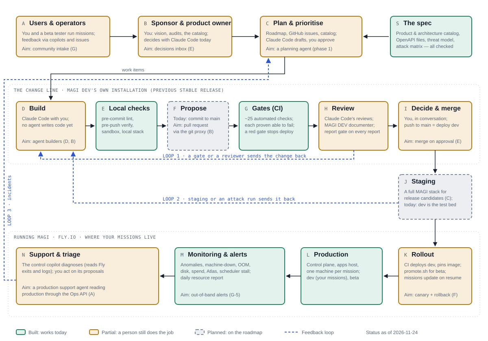

# The MAGI software factory

The factory we are building toward: MAGI developed, reviewed, released and operated by a team of
MAGI agents (MAGI DEV), with the sponsor deciding and code checking. For each station: what exists
today, who works it now, and the roadmap item that would hand it to an agent. For each piece of
automation: why it exists, who tunes it, and who acts on what it reports.

Status as of 2026-11-24. Design detail lives in
[magi-dev-requirements.md](plans/magi-dev-requirements.md) (deliverables A–H, phases) and
[security-assurance-plan.md](plans/security-assurance-plan.md) (the checks); sprint status in
[MAGI_V3_ROADMAP.md](../MAGI_V3_ROADMAP.md).

Letters in brackets after "Aim" are the platform deliverables of the requirements: **A** production
Ops API, **B** source control (git proxy, GitHub Apps, rulesets), **C** staging installation,
**D** in-VM sandbox, **E** governance engine, **F** rollout and rollback, **G** external API gateway.
Loop 1: a gate or a reviewer sends a change back to its builder. Loop 2: staging or an attack run
sends it back. Loop 3: incidents in production become work items.

## Who works in the factory

| Role | Today |
|---|---|
| **The sponsor** (the user) | Product owner: what to build and what to merge. Commissions independent audits that establish what automation is needed, accepts the tools proposed, validates the catalog they enforce. Also an operator of real missions. |
| **Claude Code** | The engineer: builds, reviews with its own commands, designs and tunes the automation, reads MAGI DEV's reports. The fallback if MAGI DEV breaks itself. |
| **MAGI DEV agents** | A mission of reviewers on dev: documenter (active); appsec, code reviewer, QA lead (paused 2026-11-23); mission copilot. Planned: a production support engineer, builders. |
| **Copilots** | The control-plane copilot diagnoses missions and proposes actions; each mission's copilot does the same inside its mission. Every external write is a card the operator confirms. |
| **Code** | The gates, scanners, tests and monitors. Its verdicts cannot be argued with, which is why it decides wherever a check can be written. |

## The stations

| | Station | Status | Aim | Today | Next |
|---|---|---|---|---|---|
| A | Users & operators | Partial | Feedback from every user reaches the factory as work, with private channels for anything security-related. | The sponsor and one beta tester (`prod-beta`) run missions. Feedback arrives in conversation, through the copilots, or as GitHub issues (a copilot's issue is a card the operator confirms). | GitHub connector and community reading for MAGI DEV (G, sprint 32; phase 1, sprint 33). |
| B | Sponsor & product owner | Partial | Decisions through a decisions inbox: typed requests with facts the platform computes, under rules that say which decisions are the sponsor's. | The sponsor decides with Claude Code, in conversation: the sponsor commissions audits and accepts designs, Claude Code proposes and builds. Intent is written down in the catalog (ADR-0036), which the sponsor validates, and the roadmap. | Governance engine (E, sprint 31), piloted on meteo. |
| C | Plan & prioritise | Partial | Incidents, findings and requests become prioritised work items with owners and stage gates. | The roadmap, GitHub issues, `docs/plans/`. Claude Code drafts, the sponsor approves. Missions have an objectives store with tasks; MAGI DEV has no queue of its own. | Stage gates on tasks (E); a planning role (phase 1). |
| S | The spec | Built | One written statement of what MAGI should do that people and checks both compare the code against. | The catalog in `packages/agent-config/src/baseline/` (operations, entities, invariants, components); `npm run trace` compares the code with it. The OpenAPI files, the threat model and the attack matrix are generated or test-checked. | Trace reports delivered to the reviewers (30t, T3). |
| D | Build | Partial | Agents build in their own workspace on the mission machine, with tests, a local database and a test budget for model calls. | Claude Code with the sponsor. MAGI DEV only clones the public repository and reads it. | In-VM sandbox (D) and the git proxy (B, sprint 32); first writer: the documenter's documentation pull requests. |
| E | Local checks | Built | Whoever builds runs the same checks as CI before proposing, including the attacks. | Pre-commit lint, pre-push `npm run verify`; the attack sandbox and the local scanning stack run in Docker in minutes. | The same, inside the agents' sandbox (D). |
| F | Propose | Planned | Every change is a pull request from an identity with only its role's rights; rulesets forbid direct pushes to `main`. | Solo development: commits go straight to `main`, guarded by the pre-push hook and CI. | A GitHub App per role and the git proxy (B, sprint 32). |
| G | Gates (CI) | Built | Code decides everything a check can decide, and each check proves it can fail. | Build, lint, tripwires, ratchets, tests, static and secret scans, workflow and image scans, contract tests, the attack sandbox (the register below). | Deployed-configuration checks, a nightly scan of the running images (assurance plan, step 7). |
| H | Review | Partial | Agents review each change through narrow, checkable questions, sampled more than once and challenged by a refuter. | Claude Code's `/security-review` and `/code-review`. The documenter checks each day's commits reliably; appsec, the code reviewer and QA are paused after inventing evidence. The report gate rejects any report citing what does not exist (8 of the first 13). | MAGI DEV redesign (assurance plan, step 6), scored against known answers (#96). |
| I | Decide & merge | Partial | A change merges when its gates pass and the decider named by policy approves; a production release has the sponsor as required reviewer. | The sponsor approves in conversation; the push to `main` deploys dev. | Merge queue and protected release environment (B); approvals through the inbox (E). |
| J | Staging | Planned | Release candidates run on a full MAGI stack first: the integration suite, isolation tests, an end-to-end mission. | No staging: dev is both test bed and where the sponsor's real missions run. The attack sandbox and the local stack cover part of it. | Staging installation (C). |
| K | Rollout | Partial | A release reaches running missions canary first, with health checks and automatic rollback. | CI deploys the control plane and pins the new mission image; `promote.sh` deploys a named environment such as beta. A running mission takes the new image only on suspend and resume. | Rollout and rollback (F), through the Ops API (A). |
| L | Production | Built | MAGI on Fly.io, isolated per mission, and MAGI DEV on its own installation one release behind. | Control plane, apps host and one machine per mission, on `dev` (the sponsor's real missions) and `prod-beta`. MAGI DEV runs as a mission on dev. | MAGI DEV's own installation (phase 1, sprint 33). |
| M | Monitoring & alerts | Built | Every failure mode has a detection that reaches someone who can act, even when MAGI is down. | Daemon anomalies; resource alerts with hysteresis (disk, spend, upgrades, OOM, Atlas); `machine-down`; `scheduler-stall`; a daily resource report; relayed to the copilots and the sponsor. | Out-of-band alerting (G-5); the detections list per trust boundary (assurance plan, step 7). |
| N | Support & triage | Partial | A support agent reads production, diagnoses, and proposes actions the sponsor approves; incidents become work items (loop 3). | The control copilot, with the `incident-triage` skill and Fly's exit records and logs, owner-scoped. Wider Fly access is postponed until tokens can be scoped. | Ops API read tier (A), the production support engineer role, the action tier under governance (E). |

## Who decides, tunes and acts

These rules describe how automation is governed now, and carry over to MAGI DEV as the platform
gains autonomy.

1. **What automation exists is a joint decision.** The sponsor commissions independent audits that
   establish the need: the code review audit of August 2026, the third-party audit of October 2026,
   the research behind the security assurance plan. The engineer designs a suite of tools to meet
   it; the sponsor accepts or rejects the design. Neither adds or removes a gate alone.
2. **The engineer tunes; the sponsor validates the catalog.** Thresholds, rules, templates and
   exceptions are the engineer's to tune. A change that loosens a check carries its reason in
   place, an expiry where it can, and is reported to the sponsor in the same session. The sponsor's
   check is the catalog: the operations, invariants and attack classes the checks enforce, and the
   [attack matrix](security/attack-matrix.md) of which are covered.
3. **Every piece of automation has one owning role.** The owner keeps its configuration current,
   proves it can still fail (controls, mutations, planted targets), and proposes changes. Today
   Claude Code holds every one. In MAGI DEV: security scanners to appsec; documentation generators
   and freshness tests to the documenter; tests and coverage to QA; the CI pipeline to the code
   reviewer until a release role exists; runtime detections to the production support engineer.
4. **A blocking check is acted on by whoever made the change.** No triage step: the change does not
   land until the check passes or the sponsor accepts an exception.
5. **A reporting check has a named reader and a cadence.** Each report-only output is triaged by its
   owning role into a fix, a work item, or an exception for the sponsor. An output nobody reads is
   given a reader or switched off.
6. **Agents triage; they never certify.** An agent's answer is a finding with evidence that code can
   check, never "all clear". Its reports pass the report gate before anyone reads them.
7. **The same model in MAGI DEV.** The sponsor still commissions independent audits, now also of
   MAGI DEV's own work. The owning roles design and tune in place of Claude Code; their proposals and
   every change to the catalog reach the sponsor through the decisions inbox (E). Claude Code remains
   an independent reviewer and the fallback.

## The automation register

"Blocks" means a failure stops the commit, the push, the deploy or the image; "Reports" means
someone has to read it. **Gap** marks an output nobody reads on a schedule today. After "→", the
owner in the aim.

| Automation | What it catches | Effect | Need established by | Tuned by | Acts on output (today → aim) |
|---|---|---|---|---|---|
| **Before the change leaves the machine (station E)** | | | | | |
| **Pre-commit lint** `Biome, git hook` | Formatting and lint rules | Blocks | Code-quality practice | Claude Code (`biome.json`) | The author, at once → *the building agent* |
| **Pre-push verify** `npm run verify` | Everything in the first CI job, before it reaches CI | Blocks | Third-party audit, Oct 2026 (sprint 28f) | Claude Code | The author → *the building agent* |
| **Pre-push Semgrep** `npm run audit:semgrep-changed` | CI's Semgrep rules on the files the push changes, so a finding is fixed before CI sees it | Blocks | A Semgrep finding that reached CI, 2026-11-24 (Ajv `allErrors`) | Claude Code (`scripts/security/semgrep-changed.sh`) | The author → *the building agent* |
| **Watched guards** `npm run audit:watched-guards` | A push that changes a file holding a security property on its own (`scripts/security/watched-guards.json`: the SSRF chain today) without a `Security review:` line in one of its commits | Blocks | CodeQL's SSRF alert #2, dismissed as a false positive on 2026-11-25: the sponsor asked for close attention to that code | Claude Code (the list); the sponsor validates additions | The author → *the building agent; MAGI DEV re-reviews each guard on every change* |
| **On every push to main (station G, `quality.yml`)** | | | | | |
| **Build, typecheck, unit tests** `~1,900 tests, incl. property tests` | Broken code; guards that fast-check can defeat (paths, schedules, tool arguments, tickets, markdown) | Blocks | Testing practice; property tests: Security assurance plan, step 5 | Claude Code, with each test | The author → *the building agent; QA watches for gaps* |
| **Coverage ratchet** `vitest thresholds` | Coverage falling below each package's floor | Blocks | Third-party audit, Oct 2026 (sprint 28f) | Claude Code; a lowered floor carries a comment saying why | The author → *the building agent* |
| **Structure ratchet** `audit:structure` | Files over 600 lines, functions over 120 | Blocks | Third-party audit, Oct 2026 (sprint 28f) | Claude Code | The author |
| **Tripwires T1–T15** `scripts/audit/tripwires.sh` | Known bad patterns: env from tenant input, raw HTML sinks, unchecked path joins, raw mailbox writes, model ids outside the tables… | Blocks | Third-party audit, Oct 2026 (sprint 28f) | Claude Code; each has a planted self-test and an allow-list | The author |
| **Semgrep** `community rules + 4 of ours` | Injection and unsafe patterns; our sudo, path and query rules, each tested on planted code | Blocks | Sprint 14/15 quality gates; our rules: Security assurance plan, step 2 | Claude Code | The author → *appsec proposes new rules* |
| **Secret scan** `gitleaks` | A credential committed to the repository | Blocks | Sprint 14/15 quality gates; in CI since the Oct 2026 audit | Claude Code | The author; the sponsor rotates |
| **Dependency audit** `production, high and above` | Known-vulnerable production dependencies | Blocks | Third-party audit, Oct 2026 (sprint 28f) | Claude Code (`.nsprc`) | The author |
| **Workflow and Dockerfile scans** `actionlint, zizmor, shellcheck, trivy config` | Unsafe CI workflows, shell bugs, Dockerfile misconfiguration | Blocks | actionlint: Third-party audit, Oct 2026 (sprint 28f); the rest: Security assurance plan, step 2 | Claude Code | The author |
| **Contract and freshness tests** | OpenAPI files, attack matrix, env doc and catalog docs out of date; a route without an operation or auth; a covered matrix cell whose test does not exist | Blocks | ADR-0036; Security assurance plan, steps 2b and 3 | Claude Code | The author → *the documenter watches the docs it doesn't generate* |
| **Trace** `npm run trace, report only` | Code and catalog disagreeing: writes, status transitions, layering, unenforced invariants | Reports | ADR-0036 | Claude Code | Claude Code reads "new since the last run" before each relevant commit → *the code reviewer (30t, T3)* |
| **CodeQL** `GitHub default setup` | Data-flow vulnerabilities in TypeScript, Python, workflows | Reports | Repository setting | GitHub defaults | **Gap:** alerts in code scanning, no routine reader → *appsec triage, one alert per question* |
| **Building the mission image (`build-execution-image.yml`)** | | | | | |
| **Image gate** `trivy` | Fixable critical vulnerabilities; any secret baked into a layer | Blocks | Security assurance plan (image hardening) | Claude Code; exceptions in `.trivyignore.yaml` must expire | The author |
| **Image scan, high** `trivy` | High vulnerabilities in what ships | Reports | Security assurance plan, step 2 | Claude Code | **Gap:** code scanning, no routine reader → *appsec triage* |
| **Attack sandbox** `20 cells` | The shipped image attacked from inside as its agents: OS isolation, sudo, job and schedule spoofing, token theft, secrets in subprocesses, firewall | Blocks | Security assurance plan, step 4 | Claude Code; each cell has a control | The author; details in code scanning → *new cells proposed from open matrix rows* |
| **Nightly (`security-nightly.yml`)** | | | | | |
| **Local stack scan, our templates** `Nuclei, environment B` | Cross-tenant reads, unauthenticated routes, missing headers, exposed files and source maps, leaking errors | Fails the run | Security assurance plan, step 5 | Claude Code; each template proven on a planted server | GitHub emails the sponsor a failed run; Claude Code fixes → *appsec* |
| **Local stack scan, community and DAST** `Nuclei, pinned templates` | Known exposures, misconfigurations and CVEs; fuzzing of every API route | Reports | Security assurance plan, step 5 | Claude Code (template release, tags) | **Gap:** code scanning, no routine reader → *appsec triage* |
| **GitHub services** | | | | | |
| **Dependabot alerts** | Vulnerable dependencies, including development ones | Reports | Security assurance plan, step 2 | — | **Gap:** read on request; five major upgrades waiting (vitest 5, firebase-admin 14, exceljs, Stagehand's SDK, mermaid 12) → *appsec triages, a builder upgrades* |
| **Running MAGI (station M)** | | | | | |
| **Daemon anomalies** `crash, timeout, scheduling, repeated tool failure` | A mission misbehaving | Reports | Resilience practice; incidents | Claude Code | The mission copilot, then the sponsor → *the support agent* |
| **Resource and machine alerts** `ADR-0032, fly-events` | Disk, spend, upgrades, OOM, Atlas storage, a machine down, a scheduler stall | Reports | ADR-0032; the AI News outage (machine-down); F-083 (scheduler stall) | Claude Code (thresholds in env) | The control copilot diagnoses; the sponsor acts → *the support agent proposes, the sponsor approves* |
| **Spend caps and ceilings** | A mission or agent spending past its limit | Pauses | ADR-0034 | The sponsor sets caps; only the admin raises a ceiling | The sponsor |
| **Daily resource report** | Trends: disk growth, spend, chronic upgrades | Reports | ADR-0032 | Claude Code | The sponsor |
| **MAGI DEV's own checks (station H)** | | | | | |
| **Report gate** `report-gate.py, a scheduled job` | Reports citing files, lines, tests, commits or ids that do not exist | Rejects | MAGI DEV's invented evidence, 2026-11-22/23; Security assurance plan, step 1 | Claude Code (`check-citations.py`) | Claude Code reads only accepted reports, and verifies before acting → *rejections go back to the author* |
| **Documenter's daily check** | Documentation that no longer matches the code | Reports | MAGI DEV phase 0 | Claude Code (skills in `config/teams/magi-dev/`) | Claude Code, at the start of a session → *the documenter's own pull request* |

## Gaps in ownership today

- **Code scanning has no reader.** CodeQL, trivy's high findings, and the nightly community and DAST
  scans land there and nobody reviews them on a schedule. The first job for a redesigned appsec
  (assurance plan, step 6).
- **Dependabot is read on request.** Five upgrades that each need a major version are waiting.
- **Rejected reports go nowhere.** The report gate rejects them, but their authors are paused and
  nothing sends a rejection back.
- **Runtime alerts stop at the sponsor.** If the sponsor is away and MAGI is down, no alert leaves
  MAGI (G-5).

## Keeping this current

A new piece of automation, or a change to who tunes or reads one, updates the register in the same
commit; a station that changes status updates its row and the diagram (`software-factory.svg`).
The documenter checks this file against the code like any other document.
